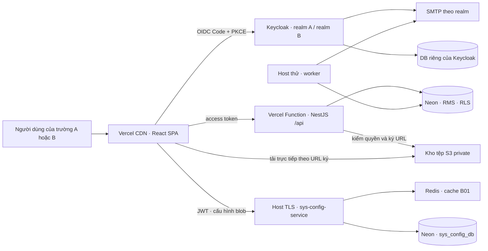

# Hồ sơ duyệt kiến trúc RMS v0

**SA chọn một web React dùng shadcn/ui, một API nghiệp vụ NestJS theo module, Neon PostgreSQL dùng chung có RLS và một realm Keycloak cho mỗi tổ chức.** V0 lấy đợt A làm mốc nghiệm thu đầu tiên. Hai trường giả lập dùng cùng bản web để mở kỳ, nộp, trả bổ sung, chấm và đối chiếu tổng theo khoa. Đợt B nối đến quyết toán. Đợt C bật riêng năng lực mở rộng và trợ lý theo từng tenant. [Lộ trình](../product/roadmap.md) · [Bản giao việc](../guides/ke-hoach-implement-rms.md) · [Kế hoạch kiểm chứng](../guides/kiem-thu-rms.md)

## Quyết định triển khai ngày 24/11/2026

SA chốt thiết kế trong phạm vi được giao. Platform có thể nhận N01 trên checkout hiện tại. Cột kiểm chứng ghi bằng chứng người nhận phải tạo trong lúc thực hiện hoặc trước pilot. Ops và chủ ngân sách xác nhận môi trường dùng thật khi nhận N11/N14.

| Mã | Quyết định của SA | Người nhận và phép kiểm |
|---|---|---|
| SA-01 | Local/CI dùng web hiện có, NestJS, PostgreSQL, Keycloak, Redis, kho tệp và SMTP thử. N01 thêm backend và hợp đồng health vào monorepo. Vercel/Neon là phương án môi trường tích hợp cho N11 khi có tài nguyên phù hợp. | Platform chạy checkout sạch, sinh client và gọi health. Ops ghi host TLS, quota, vùng, SMTP, chi phí và kết quả cold/warm trước pilot. |
| SA-02 | Một realm mỗi tenant. B03 định danh bằng issuer + sub, mỗi tài khoản có đúng một userType. RMS kiểm tài khoản, quyền hiệu lực và phạm vi ở từng request, kể cả ở B01. Quyền ghi shared cấp riêng trong IAM cho chủ thể vận hành đã định danh. | IAM/BA dùng hai người khác vai trò. Kiểm sau khi khóa hoặc hạ quyền ở cả hai API. Tenant admin chỉ ghi bản riêng. |
| SA-03 | Dùng pool với context giới hạn trong transaction, RLS bắt buộc và FK ghép tenant. Credential migration tách khỏi runtime. | DBA chạy N02, luân phiên hai tenant qua pool một kết nối, kiểm commit, rollback và trường hợp thiếu context. |
| SA-04 | Đăng ký VP-THEME. Catalog quản lý revision bất biến, draft, publish và rollback bằng expected revision. N05 dựng hai theme, N06/N07 tích hợp. | Design/BE kiểm màu, focus, portal, phục hồi và hai lần publish cùng revision cho đúng một lần thành công. |
| SA-05 | B01 có host TLS và DB riêng, Redis TTL 5 phút cho nội dung nhỏ, giới hạn upload 20 MiB. Adapter catalog dùng hợp đồng tập trung. IAM kiểm scope trước cả cache hit. | BE/N11 kiểm blob 6 MiB, vượt trần, override và thay shared trong khi hai tenant đang dùng fallback. |
| SA-06 | Ghi outbox, history và audit cùng giao dịch đổi trạng thái. Worker xử lý ít nhất một lần bằng lease, khóa nghiệp vụ và ledger từng kênh. Mục tiêu thử tải và khôi phục theo kế hoạch QA. | BE/N09 kiểm replay sau khi commit, chỉ một tin in-app. Ops/QA kiểm gửi thư bất định, đo tải N13 và diễn tập phục hồi N14. |

[Đặc tả B03](../features/B03-quan-ly-nguoi-dung/spec.md) · [Thiết kế B01](../features/B01-danh-muc-cau-hinh/design.md) · [Các phiếu N01–N14](../guides/ke-hoach-implement-rms.md)

## Cấu trúc chạy thử

Một project Vercel cho web tĩnh, một project cho API Node. Web dùng URL API cố định theo môi trường. Hai slug seed dùng đường dẫn `/t/{slug}` để chưa cần mua domain riêng cho mỗi trường. Một tên miền HTTPS cố định cho callback pilot. SPA dùng PKCE S256, state, nonce, redirect URI chính xác. Giữ token trong bộ nhớ, mở lại trang qua phiên SSO. Access token gửi trong Authorization header. API đối chiếu chữ ký với JWKS của issuer đã đăng ký, thuật toán cho phép, issuer, audience dành cho API và thời hạn. Tách client public của SPA, audience của hai API và credential của worker. [Keycloak OIDC](https://www.keycloak.org/securing-apps/oidc-layers) · [NestJS trên Vercel](https://vercel.com/docs/frameworks/backend/nestjs)

API xử lý lệnh đồng bộ ngắn. Trong cùng transaction, P01 kiểm vai trò, guard và version của graph, khóa phiên bản dòng đề tài, cập nhật trạng thái ngữ nghĩa, ghi history, P02 và outbox. Khóa duy nhất theo tenant, đối tượng, mã thao tác cho retry. Worker chỉ nhận việc đã commit, giữ lease có hạn, retry có backoff, chuyển lỗi lặp sang danh sách xử lý thủ công. Event có tenant, actor và correlation ID. Mỗi lần chạy lại phải kiểm quan hệ nguồn. Định danh thông báo theo tenant, sự kiện, người nhận, kênh. Với SMTP có khoảng bất định sau khi mail đã gửi nhưng chưa ghi nhận thành công, dùng message ID ổn định và đối soát trước khi gửi lại. [Workflow](../features/P01-workflow-engine/spec.md) · [Audit](../features/P02-audit/spec.md)

## Tech stack và lý do chọn

| Thành phần | Lựa chọn cho repo code | Lý do và giới hạn |
|---|---|---|
| Web | React + TypeScript + Vite, React Router, TanStack Query | SPA hợp ADR-0009 và đường dẫn của 32 lát. Build tĩnh phân phối qua CDN. Query key bao gồm tenant, người dùng, bộ lọc. Xóa cache khi đổi phiên |
| UI | shadcn/ui + Tailwind CSS, component chung trong `packages/ui` | Đội sở hữu mã nguồn component, thay token màu ở runtime, cùng một form dùng được ở hai trường. Đội chịu trách nhiệm nâng cấp và kiểm accessibility sau khi sửa component. [Theming](https://ui.shadcn.com/docs/theming) |
| API | NestJS + TypeScript trên Node LTS còn hỗ trợ, REST JSON qua HTTPS | Dùng lại kiến thức/adapter từ hệ cũ, mỗi feature có module và interface. Một giao dịch cho vòng đời và audit. Giữ bootstrap HTTP riêng để đóng container bằng cùng dịch vụ khi cần. [Khả năng kế thừa](migration-coverage.md) |
| Hợp đồng | OpenAPI YAML trong `packages/api-contracts`, generate TS client và kiểm schema ở CI | Đường dẫn contract đã có trong thẻ Spec Kit. Diff contract phát hiện đổi kiểu, quyền, mã lỗi trước khi merge |
| DB | PostgreSQL Neon, Prisma với driver pg có pool, SQL migration cho RLS, khóa ghép và index | Giữ mô hình quan hệ, constraint và transaction của nghiệp vụ. Prisma giảm công CRUD. SQL được review cho phần policy. Prisma interactive transaction phải dùng cùng client từ đầu đến commit |
| Xác thực | Keycloak chạy container lâu dài, PostgreSQL riêng cho IdP, plugin email-OTP + SMTP | Realm và chính sách OTP riêng, giữ SSO khi di chuyển API. Ops phải quản lý phiên bản plugin và mail. TLS, hostname cố định, giới hạn truy cập admin. [ADR-0008](decisions/0008-keycloak-idp-dang-nhap-email-otp.md) · [Vận hành Keycloak](https://www.keycloak.org/server/configuration-production) |
| File và cấu hình | Kho S3-compatible private cho hồ sơ. B01 có DB, Redis và API blob riêng | File lớn đi thẳng tới kho bằng URL ký ngắn hạn. B01 giữ API multipart hiện có trên host riêng vì giới hạn payload của Function. [Spec B01](../features/B01-danh-muc-cau-hinh/spec.md) · [Giới hạn Functions](https://vercel.com/docs/functions/limitations) |
| Kiểm thử và quan sát | Vitest, PostgreSQL thật, Playwright, axe và k6. Log JSON, OpenTelemetry, dashboard độ trễ/lỗi theo route | So sánh được rule đơn lẻ, commit thật và kết quả người dùng nhìn thấy. Track pool wait, queue age, quota DB. Correlation ID nối request và worker. Ẩn token, OTP, email và nội dung đề tài |

N01 dùng Node/pnpm của monorepo, ghim dependency API/client trong lockfile và kiểm build local/CI. N02 ghim Prisma/pg và chứng minh cách ly trên pool. N03 ghim cặp image Keycloak/SPI và kiểm callback OTP. N11 xác minh runtime ở môi trường được cấp. Hai hạng mục tốn công vận hành nhất là IdP và B01. Tách thêm service nghiệp vụ khi trace cho thấy một module cần scale độc lập và giao dịch liên quan đã có hợp đồng sự kiện.

## Ranh giới tenant từ đăng nhập tới dữ liệu

1. Registry do Ops quản lý ánh xạ slug sang tenant ID bất biến, issuer HTTPS chính xác, client ID và trạng thái hoạt động. Bootstrap chỉ trả thông tin đăng nhập công khai đã cho phép. Trước khi xác thực dùng theme gốc. API B01 và RMS tự dò issuer trong allowlist và kiểm lại tenant đang hoạt động. Slug, header và body chỉ là đầu vào cần đối chiếu.
2. Sau OTP thành công, upsert theo issuer + sub, ràng buộc email chuẩn hóa theo tenant. Cùng email ở hai realm là hai danh tính. Lần đầu gán vai trò thấp nhất theo B03, những lần sau giữ quyền hiện có. Backend đọc lại trạng thái/quyền có hiệu lực cho mỗi yêu cầu. Kiểm phạm vi đơn vị, kỳ, chủ sở hữu hoặc phân công hội đồng trước cả phép đếm. Sai token trả 401, thiếu quyền trả 403, tra ID ngoài phạm vi dùng cùng kết quả với ID không tồn tại nếu hợp đồng cho phép. [B03 hiện hành](../features/B03-quan-ly-nguoi-dung/spec.md)
3. Cổng dữ liệu của mọi module yêu cầu `TenantContext`. Bắt đầu transaction, đặt `set_config('app.current_tenant', tenantId, true)` bằng tham số, đọc/ghi bằng **chính transaction đó**. RLS dùng cả USING và WITH CHECK, bật FORCE trên bảng nghiệp vụ. Runtime role không là owner, superuser hoặc BYPASSRLS. Policy coi context rỗng/thiếu là không có dòng hợp lệ. FK cha–con và unique có tenant ID. Migration dùng credential direct tách khỏi app. [Mô hình dữ liệu](data-model.md) · [Neon pooling](https://neon.com/docs/connect/connection-pooling) · [PostgreSQL RLS](https://www.postgresql.org/docs/current/ddl-rowsecurity.html)
4. B01 có ngoại lệ đọc bản shared, chỉ chủ thể quản trị hệ thống được ghi shared. Phân vai super-admin cho thao tác này phải do RMS cấp rõ. Worker lấy lease qua interface nội bộ chỉ trả ID việc và tenant, mở transaction có context để nhận payload. Bản xuất, file, hàng đợi và audit đều có tenant. Kiểm quyền tại thời điểm tải trước khi cấp URL. URL đã cấp có hiệu lực đến TTL, dùng endpoint download kiểm quyền từng lượt cho bản xuất yêu cầu thu hồi tức thì.
5. Onboard theo thứ tự tạo tenant ở trạng thái chờ, tạo realm/SMTP/client, seed graph/catalog/theme, tạo admin đầu tiên qua tác vụ bootstrap hạn quyền, kiểm đăng nhập và cách ly A/B rồi mở tenant. Thực hiện idempotent theo tenant ID. Khi ngừng phục vụ, khóa tenant ở registry, từ chối API và job mới, thu hồi phiên, sao lưu có kiểm tra và xử lý dữ liệu theo chính sách đã ký.

**Hợp đồng giữa IAM và B01.** Dùng adapter `catalog` trong backend làm điểm gọi nội bộ cho các feature dùng cấu hình. API blob B01 xác thực token đúng audience, rồi hỏi IAM qua kênh service-to-service về quyền đọc tenant, ghi tenant hoặc ghi shared của danh tính đã xác minh. Nếu IAM từ chối hoặc gián đoạn, B01 dừng thao tác được bảo vệ. Backend chỉ tin kết quả do IAM cấp cho chính subject, tenant và operation đó. IAM giữ danh sách cấp quyền shared theo issuer + sub do vận hành quản lý, tách khỏi bốn userType. Admin trường không thể tự cấp quyền này. QA sẽ thử cùng token sau khi hạ quyền. B01 vẫn sở hữu DB, Redis và hợp đồng HTTP của blob. Danh mục nghiệp vụ có FK tiếp tục thuộc module nghiệp vụ. [Spec cấu hình](../features/B01-danh-muc-cau-hinh/spec.md) · [ADR-0013](decisions/0013-cau-truc-sys-config-service.md)

## Design system theo tenant

Design lead sở hữu component Button, Input, Select, Dialog, Table, trạng thái lỗi và focus. Bản dựng web chứa theme gốc. Tenant admin soạn một bộ override có schema version, gồm các cặp màu nền/chữ (background, primary, muted), ring, radius theo thang và font từ danh mục đóng. Logo lấy asset ID đã duyệt theo VP-BRAND. Trạng thái nghiệp vụ luôn có chữ hoặc biểu tượng. Schema chỉ nhận giá trị đã chuẩn hóa. CSS tùy ý, URL font ngoài và HTML do tenant gửi bị từ chối. [VP-BRAND và VP-THEME](variation-points.md)

Trong `catalog`, dùng bảng phiên bản theme riêng gồm tenant, revision, schema version, token JSON, tác giả, thời điểm và con trỏ active theo tenant. Một revision đã áp dụng là bất biến. Màn hình quản trị có sửa nháp, xem trước trên form nộp đề tài, áp dụng và khôi phục. API kiểm quyền quản trị theo tenant, schema, độ tương phản, revision hiện tại. Publish bằng compare-and-swap trong cùng transaction ghi con trỏ và audit. Xung đột trả 409 để tải lại. Khôi phục tạo lần áp dụng mới trỏ tới bộ token đã kiểm. Draft chỉ hiển thị cho người sửa có quyền. Tính năng này mở rộng VP-BRAND qua SA-04, độc lập với thao tác PUT có hiệu lực ngay của B01 blob.

Web lấy active revision từ server sau xác thực, ghép `default → tenant override` lên root và portal của dialog. Cache token bất biến theo `tenantId:revision:schemaVersion`, revalidate con trỏ sau publish. Mất cấu hình dùng bản đã xác thực của đúng tenant hoặc theme gốc. Mẫu đối chiếu gồm hai trường có màu đối nghịch, dialog qua portal, focus bàn phím, bảng và thông báo lỗi, ở 390 px và desktop. Từ chối publish nếu chữ thường dưới 4.5:1 hoặc trạng thái focus quan trọng dưới 3:1 với nền liền kề.

## Ngân sách chạy thử và lộ trình vận hành

| Môi trường | Tài nguyên và dữ liệu | Điều kiện vận hành |
|---|---|---|
| Local / CI | PostgreSQL + Keycloak/SPI + Redis + MinIO + hộp thư test bằng container, seed A/B tái lập | Cặp realm độc lập, test migration từ DB rỗng và snapshot phiên bản trước. Không sử dụng bí mật pilot |
| V0 thử | Vercel cho web/API, Neon Free cho dữ liệu ứng dụng, host hiện có cho Keycloak, DB IdP, B01, Redis, worker và kho file thử. SMTP sandbox có inbox kiểm tra được | Dữ liệu giả. API và Neon cùng vùng gần người thử. Cho phép chính xác callback/origin cố định. Preview riêng dùng DB và realm thử, tắt auth preview chưa đăng ký |
| Pilot có dữ liệu thật | Chủ hệ thống xác nhận vùng lưu, chính sách file/log, backup, OTP delivery, năng lực và chi phí | Scale compute theo kết quả đo, chuyển worker hoặc API sang container khi thời lượng/cold start cản trở. Giữ REST và PostgreSQL để đổi hạ tầng theo module |

Neon Free hiện công bố **100 CU-giờ/tháng và 1 GB mỗi project**. Ví dụ compute 0,25 CU hoạt động 8 giờ/ngày trong 30 ngày dùng khoảng 60 CU-giờ, trước tải CI và worker. Job polling dày có thể giữ DB thức cả ngày. Đặt lịch worker theo phiên thử, ghi số CU-giờ, storage cả index, egress và function invocations sau mỗi buổi. Khi dự báo chạm 80% quota, Ops giảm thời gian thức, dọn nhánh thử hết hạn hoặc trình chi phí nâng gói. [Neon pricing](https://neon.com/pricing)

Hobby dành cho mục đích cá nhân/phi thương mại theo điều kiện của Vercel. Với pilot thương mại, lập dự toán gói Vercel phù hợp trước khi mở. Máy chạy Keycloak/B01, SMTP và lưu trữ có chủ chi phí riêng, kể cả khi tận dụng máy sẵn có. Chốt quota thực tế trong dashboard tại ngày dựng môi trường. [Điều khoản Vercel](https://vercel.com/legal/terms) · [Gói Vercel](https://vercel.com/pricing)

Ops lưu backup DB RMS/B01, DB IdP, khóa cấu hình realm, phiên bản SPI, manifest/checksum của tệp và secret tham chiếu trong secret manager. Backup hằng ngày, mã hóa, tách quyền đọc khỏi runtime. Đề xuất RPO ≤24 giờ và RTO ≤4 giờ cho pilot. Khôi phục vào môi trường cô lập, đối chiếu số đề tài, quyền, audit, checksum và OTP trước khi đổi tuyến. Migration dùng expand → backfill theo tenant → chuyển reader → contract sau cửa sổ rollback. Rollback app sang bản tương thích schema, dừng consumer khi phát hiện xử lý sai, replay có khóa idempotency. [Mục tiêu vận hành](overview.md)
