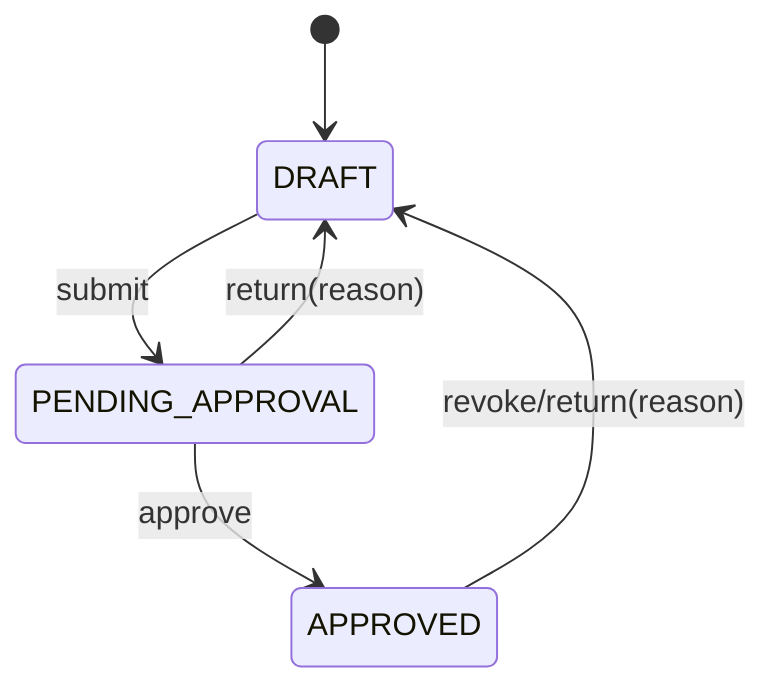

# Dự án phục vụ sản xuất — Thiết kế

Hợp đồng cho bản triển khai hiện tại nằm trong [API dự án ứng dụng](../../../packages/api-contracts/applied-project/register-applied-project.yaml).

## 1. Module & ranh giới

- **Module backend:** `applied-project` (theo ánh xạ AGENTS.md §3).
- **Entity nghiệp vụ:** `AppliedProject`, tách khỏi `ResearchProject` của F01–F06 vì F11 là đầu mục dự án
  phục vụ sản xuất, không chạy lifecycle đề tài cấp cơ sở.
- **Ranh giới kinh phí:** F11 lưu `totalBudgetVnd`/`contractValueVnd` ở mức đầu mục để thống kê và quy đổi
  giờ giảng. F11 không tạo tham chiếu sang F05 và không xử lý dự toán/giải ngân/quyết toán.

## 2. Mô hình trạng thái

Trạng thái tối thiểu:

- Mọi transition đi qua domain service của `applied-project`.
- Transition `submit`, `approve`, `return`, `revoke` ghi `AuditLog` append-only qua P02.
- UI không tự cập nhật enum trạng thái trực tiếp.

## 3. Dữ liệu khái niệm

| Khái niệm | Trường chính | Ghi chú |
|---|---|---|
| `AppliedProject` | `id`, `code`, `title`, `hostUnitId`, `principalUserId`, `startDate`, `endDate`, `contractValueVnd`, `totalBudgetVnd`, `status`, `resultSummary`, `returnReason` | Tiền VND; ngày hiển thị `dd/MM/yyyy`, lưu UTC |
| `AppliedProjectPartner` | `projectId`, `partnerId` hoặc `partnerName`, `taxCode`, `contactInfo` | Danh mục/quick-create `EXTERNAL_PARTNER` |
| `AppliedProjectMember` | `projectId`, `userId`, `roleCode`, `contributionRate` | Đầu vào phân bổ giờ P03 |
| `AppliedProjectEvidence` | `projectId`, `attachmentId`, `evidenceTypeCode`, `stage` | `evidenceTypeCode` từ `EVIDENCE_TYPE` |
| `TeachingHourSourceRef` | `sourceType=APPLIED_PROJECT`, `sourceId`, `eventKey` | Khóa idempotent cho P03 |

## 4. Tích hợp

- **B01:** `Unit`, `EXTERNAL_PARTNER`, `EVIDENCE_TYPE`, tham số `f11.teachingHourTrigger`.
- **B03:** quyền backend `APPLIEDPROJECT.VIEW`, `APPLIEDPROJECT.EDIT`, `APPLIEDPROJECT.SUBMIT`,
  `APPLIEDPROJECT.APPROVE`.
- **P02:** ghi audit cùng transaction khi đổi trạng thái hoặc điều chỉnh dữ liệu ảnh hưởng giờ giảng.
- **P03:** nhận sự kiện `APPLIED_PROJECT_APPROVED` hoặc `APPLIED_PROJECT_RESULT_APPROVED` theo cấu hình.
- **F08:** đọc bản ghi giờ giảng từ P03 để tổng hợp vào lý lịch khoa học.

## 5. Truy vết BR/AC → hiện thực

| BR/AC | Cách hiện thực |
|---|---|
| BR-01 / AC-01 | Validate `hostUnitId` bắt buộc; scope dữ liệu theo đơn vị qua RBAC/RLS của hệ thống đích |
| BR-02 / AC-02 | Lưu `DRAFT` với danh sách đối tác rỗng khi có đơn vị chủ trì và đủ các trường bắt buộc khác. Domain service kiểm ít nhất một `AppliedProjectPartner` của chính hồ sơ khi `submit`, trước khi chuyển `PENDING_APPROVAL`. Hỗ trợ chọn/tạo nhanh đối tác theo quyền. |
| BR-03 / AC-03 | Chỉ lưu trường tiền tổng; không render bảng dòng ngân sách và không tạo reference sang F05 |
| BR-04 / AC-04 | Guard `RequiredEvidenceGuard` đọc `requiredEvidence` theo giai đoạn và `EVIDENCE_TYPE` |
| BR-05 / AC-05 | Domain service kiểm transition `submit/approve/return`; lưu `returnReason` khi trả lại |
| BR-05, BR-07 / AC-06 | Audit middleware/domain event ghi `AuditLog` append-only cho approve/return/revoke |
| BR-06, BR-07 / AC-07 | Domain event sang P03 với `sourceType=APPLIED_PROJECT` + `eventKey`; P03 đảm bảo idempotent và điều chỉnh |

## 6. Điểm mở kỹ thuật

- Chuẩn hóa seed danh mục `EXTERNAL_PARTNER`: có cần mã số thuế làm khóa chống trùng không.
- Bản hiện tại ghim `f11.teachingHourTrigger` khi duyệt dự án. Mặc định là `ON_RESULT_APPROVED`. Trường xác nhận lựa chọn trước pilot.
- P03 nhận `PRINCIPAL`, `SECRETARY` (thư ký/điều phối) hoặc `MEMBER`. RV-36 cần xác nhận các tỷ lệ mặc định theo quy chế trường.

## Ghi nhận kết quả và giờ theo lần duyệt

AC-04/07 dùng phiên bản duyệt kê khai để gắn tệp kết quả và các yêu cầu P03. Chủ nhiệm gửi kết quả kèm ngày nghiệp vụ và biên bản của lần duyệt đó. Người thẩm định trả về nháp hoặc xác nhận sau khi kiểm lại loại minh chứng đang áp dụng. Với hồ sơ đã duyệt trước khi có chức năng này, lần gửi kết quả đầu tiên giữ lại số phiên bản duyệt hiện có.

Ở mốc được chọn, F11 chụp số tiền, ngày, đơn vị, vai trò và tỷ lệ từng người trong cùng giao dịch. P03 tra bậc VND và định mức theo ngày nguồn, sau đó ghi sổ F08. Thu hồi hủy yêu cầu đang chờ và đảo số giờ ròng của từng người đã ghi sổ. [Dịch vụ F11](../../../apps/backend/src/modules/applied-project/register-applied-project/service.ts) · [Migration P03](../../../apps/backend/prisma/migrations/0037_applied_result_hours/migration.sql)

**Đối tác theo AC-02.** Dịch vụ đọc danh mục B01 `EXTERNAL_PARTNER` gồm các cặp `code` và `label`. Khi lưu hồ sơ, F11 kiểm từng mã mới chọn, lưu mã và tên tại thời điểm chọn, rồi gộp với tên đối tác khai riêng. Đổi tên trong danh mục giữ nguyên bằng chứng trên dự án đã lưu. Lần lưu từ client cũ giữ liên kết danh mục cho các tên còn trong hồ sơ. [Xử lý tên và mã](../../../apps/backend/src/modules/applied-project/register-applied-project/partners.ts)
