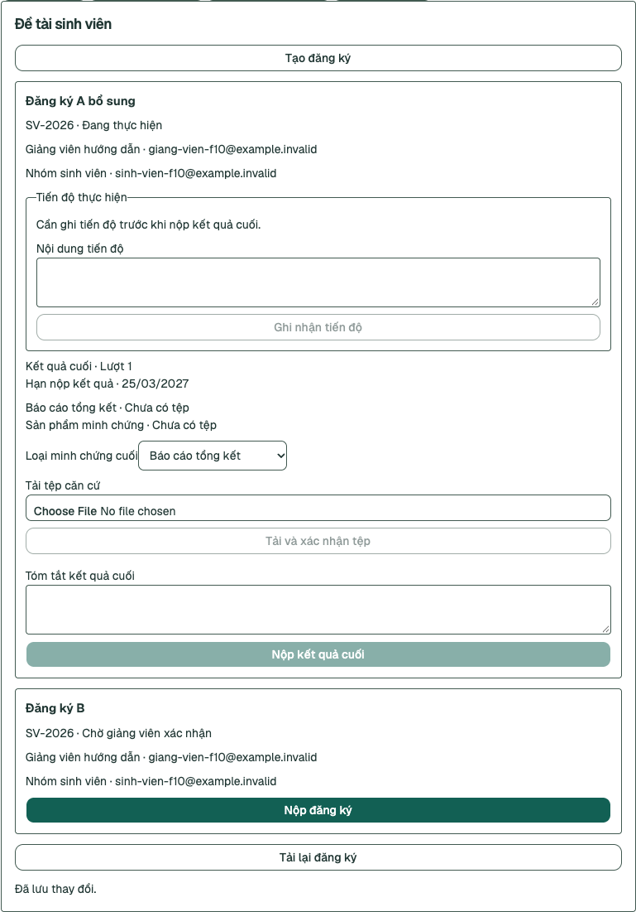

# Đăng ký đề tài và xác nhận hướng dẫn

**Sinh viên.** Mở **Đề tài sinh viên → Tạo đăng ký**. Chọn đợt, giảng viên và thành viên nhóm từ danh sách của khoa. Nhập tên đề tài, mục tiêu, sản phẩm dự kiến rồi bấm **Mời giảng viên xác nhận**. [Ảnh hai đăng ký của cùng sinh viên](../../reviews/screenshots/extension/sinh-vien-hai-dang-ky.png)

**Giảng viên.** Mở **Đề tài sinh viên**, tìm đúng tên và đợt. Bấm **Xác nhận hướng dẫn** ở đăng ký muốn nhận. Có thể nhập lý do và chọn **Yêu cầu sửa** hoặc **Từ chối hướng dẫn**. Mỗi xác nhận chỉ áp dụng cho đăng ký đã chọn. [Ảnh giảng viên xác nhận A](../../reviews/screenshots/extension/giang-vien-xac-nhan.png)

**Nộp chính thức.** Sinh viên bấm **Tải lại đăng ký**, xem trạng thái giảng viên đã xác nhận rồi bấm **Nộp đăng ký** trong thời hạn của đợt. Khi giảng viên yêu cầu sửa, mở **Sửa đăng ký**, cập nhật thông tin và gửi lời mời mới.

## Khoa duyệt triển khai

1. **Chuyên viên khoa hoặc quản trị** tải lại trang nếu trường vừa bật F10 trong phiên đang mở. Vào **Đề tài sinh viên**, mở đăng ký **Đã nộp**. Kiểm nhóm sinh viên và GVHD đã xác nhận. Chọn **Phê duyệt triển khai**. Nếu cần sửa, nhập lý do rồi chọn **Trả đăng ký bổ sung**.
2. **Trưởng nhóm** mở hồ sơ có dòng **Khoa yêu cầu bổ sung**. Bấm **Sửa đăng ký**, cập nhật và mời GVHD xác nhận lại. Sau khi giảng viên đồng ý, bấm **Nộp đăng ký**.
3. Nếu khoa thấy **Đã phê duyệt**, bấm **Bắt đầu thực hiện** khi nhóm bắt đầu dự án. Một số đợt được trường cấu hình chuyển thẳng sang **Đang thực hiện** khi duyệt. Sinh viên bấm **Tải lại đăng ký** để kiểm trạng thái của từng đề tài.

## Điều chỉnh sau phê duyệt

1. Chuyên viên khoa hoặc quản trị mở đề tài **Đã phê duyệt** hoặc **Đang thực hiện**, chọn **Điều chỉnh hồ sơ đã duyệt**. Kiểm tên, mục tiêu, sản phẩm dự kiến, thành viên và GVHD. Nhập **Lý do điều chỉnh**, bấm **Gửi bản điều chỉnh cho GVHD**.
2. GVHD được mời mở **Đề tài sinh viên → Tải lại đăng ký**. Đọc lý do, mục tiêu và thành phần nhóm của bản **Chờ xác nhận bản điều chỉnh**. Chọn **Xác nhận hướng dẫn** để nhóm trở về mốc trước đó. Khi cần sửa hoặc từ chối, ghi lý do phản hồi. Khoa mở lại biểu mẫu để xử lý. [Ảnh lời mời sau điều chỉnh](../../reviews/screenshots/extension/xac-nhan-dieu-chinh-nhom.png)
3. Trưởng nhóm tải lại để xem người hướng dẫn hiện hành. Khi hồ sơ trở về **Đang thực hiện**, nhóm tiếp tục nộp kết quả. GVHD đã xác nhận bản hiện hành thực hiện bước xác nhận cuối kỳ.

## Nộp kết quả và nghiệm thu

Trong giai đoạn **Đang thực hiện**, trưởng nhóm hoặc GVHD nhập **Nội dung tiến độ**, bấm **Ghi nhận tiến độ**. Khoa có thể tải lại đăng ký để xem nội dung, người ghi và thời điểm. Nếu đợt yêu cầu cập nhật tiến độ, nhóm cần ghi ít nhất một lần trước khi nộp kết quả cuối. Xem **Hạn nộp kết quả** trên từng hồ sơ. [Ảnh nhóm sinh viên ghi tiến độ](../../reviews/screenshots/extension/tien-do-nhom-sinh-vien.png)

1. **Trưởng nhóm** mở đề tài đang thực hiện. Trong **Kết quả cuối**, chọn từng loại minh chứng của đợt, chọn tệp và bấm **Tải và xác nhận tệp**. Kiểm tra tên tệp trong danh sách, nhập **Tóm tắt kết quả cuối** rồi bấm **Nộp kết quả cuối**. Nếu hệ thống nêu loại còn thiếu, tải đúng loại và nộp lại. [Ảnh hồ sơ đã nộp](../../reviews/screenshots/extension/sinh-vien-ket-qua.png)
2. **Giảng viên hướng dẫn** tải lại đăng ký, mở tệp và đọc tóm tắt của đúng lượt. Chọn **Xác nhận kết quả đủ điều kiện** hoặc nhập nhận xét và bấm **Yêu cầu nộp lại kết quả**. Khi được yêu cầu nộp lại, trưởng nhóm tải đủ bộ tệp cho lượt mới. Nếu đợt cho phép nghiệm thu trực tiếp, khoa có thể xử lý ngay sau khi sinh viên nộp.
3. **Chuyên viên khoa hoặc quản trị** xem hồ sơ đã đủ điều kiện. Chọn **Ghi nhận đạt**, hoặc nhập nhận xét rồi chọn **Ghi nhận không đạt**. Với kết quả không đạt, khoa có thể nhập **Hạn nộp lại kết quả**, ghi lý do và chọn **Cho nhóm làm lại**. Nhóm được nộp đến hết ngày ghi trên hồ sơ, theo giờ Việt Nam.
4. Với hồ sơ đã đạt, **khoa** bấm **Đóng đề tài**. Khi P03 đang bật, màn hình hiện **Đã gửi yêu cầu quy đổi giờ hướng dẫn**. [Ảnh khoa đóng đề tài](../../reviews/screenshots/extension/khoa-dong-de-tai-sv.png)
5. **Giảng viên** mở **Lý lịch khoa học → Xem sổ giờ giảng**. Đối chiếu tên đề tài, kỳ và định mức. Nếu yêu cầu đã gửi mà giờ chưa xuất hiện, quản trị kiểm tra lịch P03, công thức cho vai trò `MENTOR` và ngày nghiệm thu. [Ảnh sổ giờ hướng dẫn](../../reviews/screenshots/extension/gio-huong-dan-f10.png)
