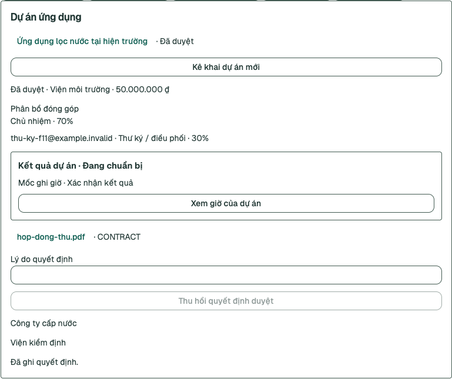
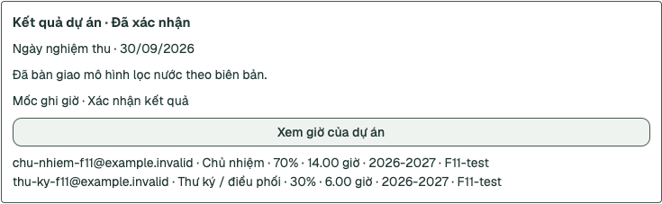

# Kê khai dự án ứng dụng

1. Khi trường bật F11, đăng nhập tài khoản người kê khai, mở **Dự án ứng dụng → Kê khai dự án mới**.
2. Điền tên, chọn đơn vị chủ trì và nhập tổng kinh phí bằng đồng. Bấm **Lưu nháp dự án**. Có thể mở lại nháp từ danh sách và bổ sung đối tác sau.
3. Chọn đối tác đã đăng ký ở **Chọn đối tác từ danh mục**. Nếu cần thêm đối tác riêng cho hồ sơ, ghi từng tên trên một dòng ở **Đối tác ngoài**. Lưu nháp rồi bấm **Gửi duyệt dự án**. Kiểm tra dòng **Chờ duyệt**, viện chủ trì và tổng kinh phí.
4. Nếu có thông báo thiếu đối tác, hồ sơ vẫn ở Nháp. Bổ sung đối tác ngay trên hồ sơ đang mở. [Ảnh hồ sơ 50 triệu đồng](../../reviews/screenshots/extension/du-an-ung-dung.png)

## Gửi và thẩm định hợp đồng

Người kê khai chọn **Loại dự án** theo danh mục của trường. Trong bản nháp đã lưu, chọn **Loại minh chứng**, chọn tệp, bấm **Tải và xác nhận tệp** rồi kiểm tra tên tệp bên cạnh mã loại trước khi gửi duyệt.

Chuyên viên cùng đơn vị hoặc quản trị mở dự án chờ duyệt và chọn **Duyệt dự án**. Khi hệ thống báo thiếu `CONTRACT`, nhập lý do rồi chọn **Trả dự án bổ sung**. Người kê khai mở lại chính dự án đó, đọc lý do và bổ sung hợp đồng. Khi cần đính chính sau duyệt, người thẩm định ghi lý do và chọn **Thu hồi quyết định duyệt**.

## Nộp kết quả và đối chiếu từng người

1. **Chủ nhiệm** chọn **Thêm thành viên** trong bản nháp. Nhập email tài khoản của trường, chọn thành viên hoặc thư ký/điều phối rồi ghi tỷ lệ phần trăm. Chủ nhiệm hưởng phần còn lại. Ví dụ, khai một thư ký 30% thì chủ nhiệm còn 70%.
2. Sau khi dự án được duyệt, mở **Kết quả dự án**, nhập ngày nghiệm thu và tóm tắt. Chọn loại tệp được liệt kê ở mục minh chứng để xác nhận, tải biên bản của lần duyệt hiện tại rồi bấm **Gửi kết quả xác nhận**.
3. **Người thẩm định** mở dự án đang chờ xác nhận và đọc biên bản. Chọn **Xác nhận kết quả dự án** nếu đủ căn cứ. Nếu cần bổ sung, nhập lý do rồi chọn **Trả kết quả bổ sung**. Chủ nhiệm mở lại cùng dự án để sửa và gửi lại.
4. Khi trường bật P03, chọn **Xem giờ của dự án**. Mỗi dòng cho biết người hưởng, vai trò, tỷ lệ, kỳ và phiên bản định mức. Nếu dòng ghi **Chờ quy đổi**, đối chiếu lịch và định mức của trường rồi xem lại. Người hưởng đối chiếu phần của mình trong **Lý lịch khoa học**.
5. Khi thu hồi quyết định dự án, ghi lý do. Mở lại sổ cá nhân để đối chiếu số giờ đã đảo. Nếu duyệt lại dự án, tải minh chứng kết quả cho lần duyệt mới.

