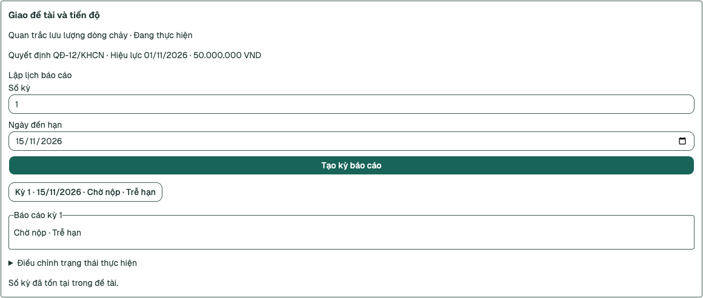
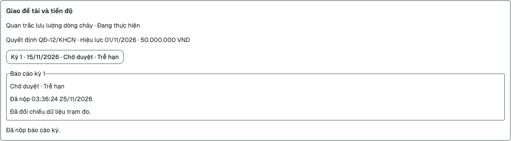

# Giao đề tài và nộp báo cáo kỳ

## Chuyên viên giao thực hiện và lập lịch

1. Mở **Hồ sơ nghiên cứu**, chọn đề tài đã phê duyệt và bấm **Giao đề tài và tiến độ**. Điền số quyết định/hợp đồng, ngày ký, ngày hiệu lực, ngày bắt đầu và kết thúc, kinh phí giao bằng VND.
2. Đối chiếu sản phẩm cam kết với thuyết minh đã duyệt. Với hồ sơ cũ chưa có cam kết cấu trúc, xác nhận số lượng theo loại sản phẩm ở quyết định giao. Ghi lý do nếu kinh phí hoặc thời gian khác đề xuất.
3. Chọn **Tải tệp căn cứ**, bấm **Tải và xác nhận tệp**. Chờ thông báo xác nhận rồi bấm **Xác nhận giao đề tài**. Trong ví dụ, đề tài chuyển sang Đang thực hiện với quyết định QĐ-12/KHCN.
4. Nhập số kỳ và ngày đến hạn, bấm **Tạo kỳ báo cáo**. Mỗi đề tài có danh sách kỳ riêng. Khi số kỳ trùng, chọn dòng kỳ đã có để đọc.

## Chủ nhiệm nộp và chuyên viên duyệt

Chọn dòng kỳ, nhập **Nội dung thực hiện** và gắn tệp báo cáo đã xác nhận. Bấm **Nộp báo cáo kỳ** rồi đọc trạng thái Chờ duyệt và thời điểm nộp. Hệ thống nhận báo cáo nộp muộn khi đề tài đang thực hiện và hiển thị nhãn Trễ hạn. Nếu đề tài đang tạm dừng, chuyên viên phải cho tiếp tục trước khi chủ nhiệm nộp.

Chuyên viên mở lại cùng kỳ, đọc báo cáo rồi chọn **Duyệt đạt** hoặc nhập nhận xét và **Yêu cầu chỉnh sửa**. Chủ nhiệm đọc nhận xét, sửa và nộp phiên bản mới. Báo cáo Đạt được khóa. Nếu cần mở lại, chuyên viên ghi lý do và dùng **Mở lại báo cáo** khi đề tài còn thực hiện.

