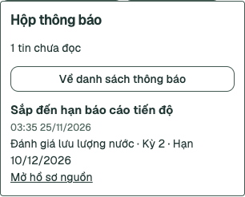
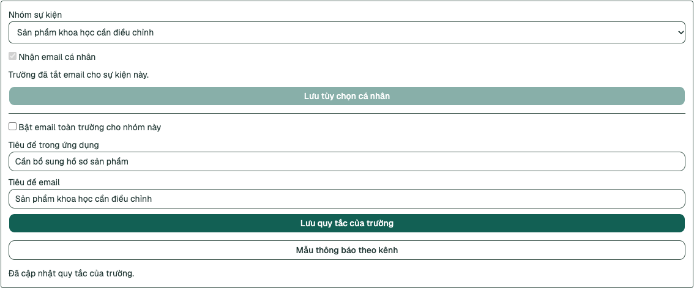
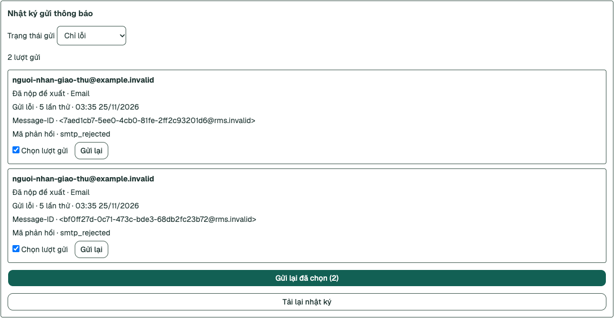

# Mở thông báo nhắc hạn và quay lại các tin chưa đọc

1. Đăng nhập đúng trường. Chọn **Hộp thông báo**, rồi **Chưa đọc**. Số ở đầu hộp thư là số tin còn lại của tài khoản đang đăng nhập.
2. Chọn **Sắp đến hạn báo cáo tiến độ**. Đối chiếu tên đề tài, số kỳ và ngày hạn. Chọn **Mở hồ sơ nguồn** để xem hồ sơ khi còn quyền. Mở tin cập nhật số chưa đọc ngay.
3. Dùng nút quay lại của trình duyệt để tiếp tục ở danh sách trước đó. Có thể tải lại trang, bộ lọc vẫn giữ nguyên. Khi hiện **Bạn đã đọc hết thông báo**, chọn **Tất cả** để xem lại tin cũ.
4. Khi muốn dọn hết hộp thư, dùng **Đánh dấu tất cả đã đọc**. Thao tác áp dụng cho các tin trong ứng dụng của tài khoản hiện tại.

Mốc nhắc theo cấu hình của trường và ngày Việt Nam. Nếu tài khoản nhìn thấy tin nhưng thiếu liên kết mở hồ sơ, liên hệ chuyên viên tiến độ để kiểm tra phân công hiện tại.

## Khi hộp thông báo tạm thời không tải được

Giữ bộ lọc đang chọn và bấm **Thử lại** bên dưới dòng **Không tải được thông báo.** Hộp thư đọc lại đúng trang và bộ lọc hiện tại. Nếu đang ở **Chưa đọc**, bạn có thể tiếp tục mở tin sau khi danh sách xuất hiện. Trong lúc chờ, bạn vẫn mở được **Tùy chọn nhận thông báo**. [Ảnh lúc gián đoạn trên điện thoại](../../reviews/screenshots/notifications/thu-lai-hop-thu.png)

## Chọn nhóm email

Trong **Hộp thông báo**, mở **Tùy chọn nhận thông báo**. Chọn nhóm sự kiện, bỏ dấu **Nhận email cá nhân** và bấm **Lưu tùy chọn cá nhân**. Tin trong ứng dụng vẫn xuất hiện. Với nhóm có dòng **Email bắt buộc cho nhóm sự kiện này**, trường giữ quyền đặt kênh.

Quản trị chọn nhóm ở cùng màn hình và dùng **Quy tắc của trường** để đổi tiêu đề trong ứng dụng, tiêu đề email hoặc trạng thái gửi email. Bấm **Lưu quy tắc của trường**. Quy tắc mới áp dụng cho sự kiện được tạo sau lần lưu.

## Soạn mẫu trong ứng dụng và email

1. Quản trị trường vào **Hộp thông báo → Tùy chọn nhận thông báo**. Chọn **Nhóm sự kiện**, mở **Mẫu thông báo theo kênh** rồi chọn **Trong ứng dụng** hoặc **Email**. Chuyên viên có thể mở và xem trước mẫu.
2. Điền **Tiêu đề mẫu** và **Nội dung mẫu**. Danh sách **Biến có thể dùng** thay đổi theo sự kiện. Với nhắc hạn, nhập `Nhắc kỳ {{period}}` làm tiêu đề và `{{projectName}} · hạn {{dueDate}}` làm nội dung. Biến `{{link}}` là đường dẫn tương đối đến hồ sơ trong RMS của trường.
3. Bấm **Xem trước** để kiểm bằng dữ liệu mẫu. Nếu màn hình báo tên biến không hợp lệ, sửa tên theo danh sách rồi xem lại. Chọn **Lưu mẫu**. Lặp lại với kênh kia nếu trường muốn dùng câu chữ khác cho email. [Ví dụ xem trước trên điện thoại](../../reviews/screenshots/notifications/xem-truoc-mau.png)
4. Khi có thông báo mới, người nhận vào **Hộp thông báo** và mở tin. Tin được tạo trước khi quản trị sửa mẫu vẫn dùng nội dung của lần tạo. Khi người nhận mất quyền xem đề tài, RMS dùng nội dung chung cho phần chứa thông tin đề tài. [Tin nhắc kỳ 4 của chuyên viên](../../reviews/screenshots/notifications/tin-theo-mau.png)
5. Muốn gỡ mẫu, kiểm lại nhóm sự kiện và kênh, chọn **Gỡ mẫu → Xác nhận gỡ mẫu**. Chữ **Thiếu mẫu cho kênh này** xuất hiện trong trình soạn. Trong **Nhật ký gửi thông báo**, chọn **Tất cả lượt gửi** để thấy cảnh báo ở lượt dùng nội dung mặc định. Nếu một quản trị khác đã cập nhật mẫu hoặc ma trận trong lúc đang soạn, chọn **Tải bản hiện hành**, đối chiếu lại rồi lưu.

## Chuyên viên xử lý email bị trả về

1. Mở **Hộp thông báo → Nhật ký gửi thông báo**. Bộ lọc **Chỉ lỗi** hiển thị lượt gửi cần xử lý. Kiểm người nhận, sự kiện, số lần thử và mã phản hồi. Chuyên viên thấy lượt gửi gắn với đề tài của khoa phụ trách. Quản trị thấy nhật ký của trường.
2. Khi đã xử lý nguyên nhân lỗi, bấm **Gửi lại** ở một dòng. Để xử lý nhiều dòng, đánh dấu **Chọn lượt gửi** rồi bấm **Gửi lại đã chọn**. Thông báo kết quả ghi số lượt đã đưa vào hàng đợi.
3. Chuyển sang **Tất cả lượt gửi** và chọn **Tải lại nhật ký**. Lượt vừa gửi lại bắt đầu ở **Chờ gửi**, 0 lần thử. Sau khi worker giao thành công, trạng thái chuyển thành **Đã gửi**.
4. Với **Chờ đối soát**, chuyển thông tin cho người vận hành SMTP đối chiếu biên nhận của cổng gửi. Kết quả đối soát quyết định thư đã giao hay cần đưa lại hàng đợi.

**Quản trị cấu hình số lần thử.** Trong B01 của trường, đặt `notification.maxRetry` thành tổng số lần thử email và `notification.retryBaseSeconds` thành số giây chờ sau lỗi tạm thời đầu tiên. Ví dụ, nhập 2 và 7 để thử tối đa hai lần, cách lần đầu khoảng 7 giây. Sau mỗi lỗi tạm thời tiếp theo, thời gian chờ tăng gấp đôi, tối đa 900 giây. Nếu B01 tạm gián đoạn, worker giữ thư trong hàng đợi và kiểm lại sau 30 giây.

## Nhận SMS cho sự kiện ưu tiên cao

1. Mở **Hộp thông báo → Tùy chọn nhận thông báo**. Chọn một sự kiện ưu tiên cao, chẳng hạn **Đã có kết quả nghiệm thu**. Kiểm tra số di động ở **Hồ sơ cá nhân** nếu màn hình nhắc cập nhật số.
2. Đánh dấu hoặc bỏ **Nhận SMS cá nhân**, rồi bấm **Lưu tùy chọn cá nhân**. Mở lại cùng nhóm để xem lựa chọn đã lưu. Ở nhóm nghiệm thu, người dùng vẫn có thể tắt SMS khi email bắt buộc. [Ảnh tùy chọn trên điện thoại](../../reviews/screenshots/notifications/tuy-chon-sms.png)
3. Quản trị có thể bật **Bật SMS toàn trường cho nhóm này** trong **Quy tắc của trường**. Khi trường tắt kênh, người dùng thấy thông báo giải thích và công tắc cá nhân bị khóa. Với sự kiện ưu tiên thường, màn hình chỉ hiện các kênh phù hợp.
4. Để đổi nội dung gửi, quản trị chọn **Mẫu thông báo theo kênh → SMS**, xem trước rồi lưu. Điện thoại nhận phần **Nội dung mẫu**. **Tiêu đề mẫu** giúp chuyên viên nhận ra sự kiện trong nhật ký.
5. Chuyên viên mở **Nhật ký gửi thông báo**. Với SMS, **Đã gửi** ghi nhận gateway đã tiếp nhận tin. Khi thấy **Chờ đối soát**, chuyển **Mã đối soát SMS** cho vận hành tra tại gateway. Khi gateway đã từ chối dứt điểm và nguyên nhân đã xử lý, có thể chọn **Gửi lại**.
