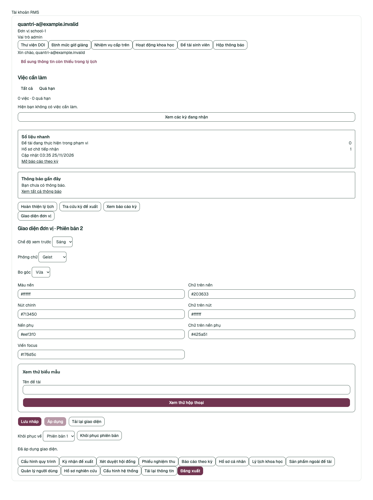

# Đổi giao diện của trường

Dành cho quản trị viên đã được cấp vai trò admin tại trường. Mở đường dẫn đăng nhập của trường, nhập email, lấy mã OTP từ hộp thư và xác nhận. Trang **Tài khoản RMS** hiển thị đơn vị của phiên. Kiểm tra đơn vị trước khi thay đổi giao diện. Ảnh dưới dùng tài khoản mẫu của trường A.

1. Chọn **Giao diện đơn vị**. Tiêu đề cho biết phiên bản đang áp dụng. Chọn **Sáng** hoặc **Tối** để chỉnh bảng màu tương ứng. Phông chữ và bo góc dùng cho cả hai chế độ.
2. Nhập màu dạng sáu chữ số hex, ví dụ `#713450`. Xem màu ở **Xem thử biểu mẫu**, rồi mở **Xem thử hộp thoại**. Bấm Escape để trở lại nút vừa mở. Khi hai màu khó phân biệt, hệ thống chỉ ra trường cần sửa và khóa nút lưu.
3. Chọn **Lưu nháp** để giữ bản đang soạn. Người dùng khác tiếp tục thấy phiên bản hiện hành. Nếu muốn bỏ các chỉnh sửa chưa lưu, chọn **Tải lại giao diện**.
4. Khi mẫu hiển thị đúng, chọn **Áp dụng**. Kiểm tra thông báo thành công và số phiên bản mới. Nếu có người đã sửa trước, tải lại để xem phiên bản hiện hành rồi thực hiện thay đổi còn cần.
5. Để quay lại màu cũ, chọn một phiên bản ở **Khôi phục về**, rồi chọn **Khôi phục phiên bản**. RMS tạo một phiên bản mới dùng lại màu cũ và lưu lịch sử.

[Ảnh trường A sau khôi phục](../../reviews/screenshots/theme/admin-a-restored.png) · [Ảnh phiên trường B sau cùng thao tác](../../reviews/screenshots/theme/reader-b-after.png)
