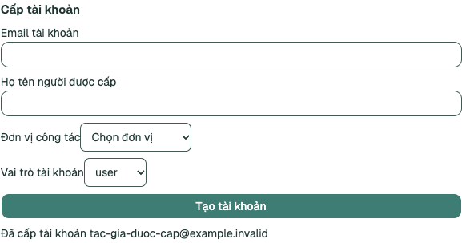

# Khóa tài khoản khi nhân sự rời đơn vị

1. Đăng nhập bằng quản trị viên của trường. Chọn **Quản lý người dùng**, nhập email vào **Tên hoặc email**, bấm **Tìm người dùng** rồi mở đúng tài khoản.
2. Đối chiếu họ tên, email và trạng thái. Chọn **Khóa tài khoản**. Kiểm lại trường và email trong bước xác nhận trước khi bấm **Xác nhận thay đổi**.
3. Màn hình chuyển sang **Đã khóa**, hiển thị sự kiện ACCOUNT_LOCKED và thời điểm. Gửi lại lệnh khóa trên cùng trạng thái giữ nguyên mã sự kiện. [Ảnh sau khi khóa](../../reviews/screenshots/iam/quan-tri-da-khoa.png)
4. Người đang mở **Hồ sơ cá nhân** sẽ nhận thông báo khi tải lại hoặc bấm lưu. Quản trị viên có thể tra lại bản lưu gần nhất tại danh sách. [Ảnh từ phiên cũ](../../reviews/screenshots/iam/phien-cu-tu-choi.png)
5. Để khôi phục quyền, mở đúng tài khoản rồi chọn **Mở khóa tài khoản** và xác nhận. Kiểm sự kiện ACCOUNT_UNLOCKED. Người dùng chọn **Tải lại hồ sơ cá nhân** để đọc bản đã lưu.

## Ngừng hoạt động tài khoản chủ nhiệm

1. Khi đã có quyết định ngừng hoạt động, quản trị viên mở đúng tài khoản trong **Quản lý người dùng**, đối chiếu trường, email và vai trò.
2. Chọn **Ngừng hoạt động**. Đọc lại email trong câu xác nhận rồi chọn **Xác nhận ngừng hoạt động**. Thẻ tài khoản hiển thị trạng thái **Ngừng hoạt động**, sự kiện `ADMIN_DELETE_USER` và thời điểm. Tài khoản ở trạng thái này kết thúc quyền truy cập. [Ảnh sau khi xác nhận](../../reviews/screenshots/iam/ngung-hoat-dong-chu-nhiem.png)
3. Chuyên viên có quyền theo khoa mở đề tài bằng mã đã cấp, đối chiếu tên chủ nhiệm, lần nộp lại và lịch sử trước đó. Người đã ngừng hoạt động vẫn đứng tên trên hồ sơ. [Kịch bản đối chứng](../../../e2e/iam/lock-account/inactive-principal.ts)

## Yêu cầu quyền tác giả

1. Người dùng mở **Hồ sơ cá nhân → Yêu cầu quyền tác giả**. Nhập học hàm hoặc học vị, chuyên môn và đường dẫn HTTPS tới minh chứng. Chọn **Gửi yêu cầu lên tác giả**, kiểm tra trạng thái **Chờ duyệt**.
2. Quản trị mở **Quản lý người dùng → Xét yêu cầu quyền tác giả**. Chọn **Thẩm định** theo email, đối chiếu minh chứng. Chọn **Duyệt quyền tác giả** hoặc nhập ý kiến rồi **Từ chối yêu cầu**. [Ảnh thẩm định](../../reviews/screenshots/iam/tham-dinh-quyen-tac-gia.png)
3. Người dùng mở lại yêu cầu và chọn **Tải lại yêu cầu** để xem kết quả. Sau khi được duyệt, chọn **Tải lại thông tin** để thấy vai trò author. Khi bị từ chối, đọc ý kiến, bổ sung minh chứng và gửi yêu cầu mới. [Ca kiểm hai vai trò](../../../e2e/iam/author-request/acceptance.spec.ts)

## Cấp tài khoản trước lần đăng nhập đầu

Trong **Quản lý người dùng**, mở **Cấp tài khoản mới**. Điền email, họ tên, chọn đơn vị công tác và vai trò đã được duyệt rồi bấm **Tạo tài khoản**. Kiểm tra thông báo xác nhận đúng email. Người nhận mở trang của trường, đăng nhập bằng chính email đó và nhập OTP. Ở lượt thử, người nhận vào thẳng tài khoản author vừa cấp, cùng đơn vị và đúng ba quyền theo vai trò.

