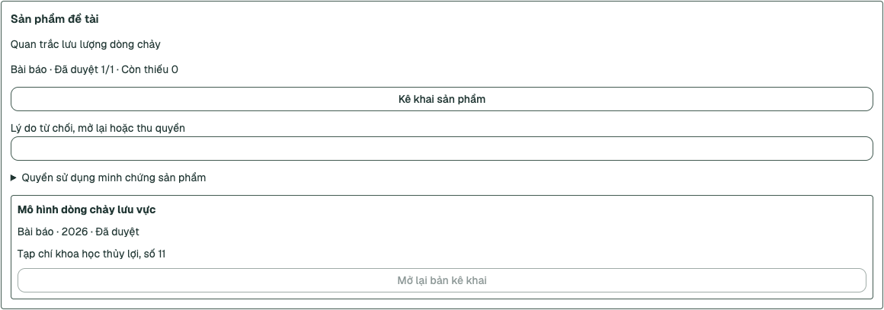
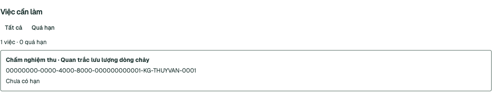
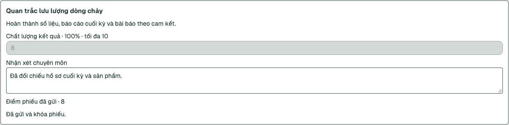
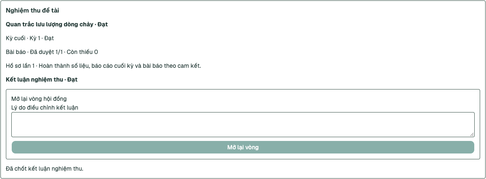

# Từ kê khai sản phẩm đến nghiệm thu đề tài

## Chủ nhiệm kê khai sản phẩm

1. Trong **Hồ sơ nghiên cứu**, mở đề tài rồi chọn **Sản phẩm khoa học**. Chọn **Kê khai sản phẩm**, nhập tên, loại, năm, thông tin công bố và tác giả.
2. Chọn minh chứng đã được xác nhận trong đề tài hoặc tải tệp mới. Chọn **Lưu nháp sản phẩm** và **Gửi duyệt sản phẩm**. Khi có thông báo tệp hết quyền, mở lại danh sách, chọn **Sửa bản kê khai**, thay tệp và gửi lại.
3. Theo dõi **Đã duyệt** và **Còn thiếu** của từng loại cam kết. Hai bài báo không thể bù cho một sáng chế còn thiếu.

## Chuyên viên duyệt sản phẩm

Mở **Sản phẩm khoa học** trong đề tài phụ trách. Kiểm tác giả, thông tin công bố, loại và minh chứng trước khi chọn **Duyệt sản phẩm**. Khi trả lại, điền lý do để chủ nhiệm biết cần sửa gì. Trường hợp phải thu quyền sử dụng tệp cho F07, nhập lý do rồi chọn đúng tệp dưới **Quyền sử dụng minh chứng sản phẩm**.

## Chủ nhiệm đăng ký nghiệm thu

Mở **Nghiệm thu đề tài**. Kiểm số kỳ cuối cùng, kết quả Đạt và số lượng sản phẩm còn thiếu của từng loại. Điền tóm tắt, chọn tệp hồ sơ cuối đã xác nhận, sau đó bấm **Nộp hồ sơ nghiệm thu**. Chuyên viên phụ trách nhận tin và hồ sơ chuyển **Chờ nghiệm thu**.

## Hội đồng chấm và chuyên viên chốt kết luận

1. Chuyên viên vào **Việc cần làm**, chọn **Điều phối nghiệm thu** của đề tài thuộc khoa mình. Mở **Lập hội đồng nghiệm thu**, chọn thành viên và chức danh. Chọn bộ tiêu chí rồi bấm **Mở đợt nghiệm thu**.
2. Thành viên hội đồng mở **Việc cần làm → Tất cả → Chấm nghiệm thu** của đúng đề tài. Đọc tóm tắt hồ sơ và tiêu chí. Chọn **Lưu nháp phiếu** nếu cần quay lại. Khi nhập đủ điểm, chọn **Gửi phiếu chấm**, kiểm dòng **Điểm phiếu đã gửi**, rồi chọn **Về danh sách việc**. Thành viên cũng có thể mở **Phiếu nghiệm thu** trên trang tài khoản để đọc lại phiếu trong lúc đợt còn mở.

   

   

3. Chuyên viên chọn **Chốt kết luận nghiệm thu**. Nếu thiếu phiếu, màn hình ghi số còn thiếu của chính đợt nghiệm thu. Khi kết luận **Đạt**, mở sổ kinh phí để quyết toán theo chế độ của trường. [Hướng dẫn sổ kinh phí](so-kinh-phi.md)

   

## Điều chỉnh kết luận nghiệm thu

Trước khi quyết toán, chuyên viên mở **Nghiệm thu đề tài**, ghi **Lý do điều chỉnh kết luận** và chọn **Mở lại vòng**. Kiểm lại điểm trong lịch sử, nhận phiếu bổ sung của người còn đủ điều kiện rồi chọn **Chốt kết luận nghiệm thu**.

Sau khi khóa sổ, chọn **Chủ quy trình nhận yêu cầu**, ghi rõ nội dung cần đối chiếu và bấm **Gửi yêu cầu đính chính**. Mục lịch sử ghi tài khoản nhận và lý do. Người nhận mở hộp thông báo của trường để xem yêu cầu. [Ảnh chuyển đính chính sau khóa sổ](../../reviews/screenshots/acceptance/chuyen-dinh-chinh.png)

### Chọn loại sản phẩm của trường

Mở đề tài, chọn **Sản phẩm khoa học → Kê khai sản phẩm**. Chọn **Loại sản phẩm** theo tên do trường công bố. Ví dụ, trường có thể bổ sung loại **Bản đồ nghiên cứu**. Nhập tên, năm, thông tin công bố, chọn tác giả và minh chứng. Lưu nháp rồi chọn **Gửi duyệt sản phẩm**. [Ảnh sản phẩm theo danh mục trường](../../reviews/screenshots/product/loai-san-pham-cua-truong.png)

Nếu trường ngừng dùng một loại khi bản nháp đang mở, hệ thống giữ bản nháp và báo lỗi lúc gửi. Chọn **Sửa bản kê khai**, chọn loại đang áp dụng theo hướng dẫn của khoa, lưu rồi gửi lại. Hồ sơ đã có cam kết chính thức giữ số lượng và mã đã ghi nhận khi giao thực hiện.

### Kê khai sản phẩm ngoài đề tài RMS

1. **Tác giả** mở **Sản phẩm ngoài đề tài → Kê khai sản phẩm độc lập** ở màn hình tài khoản. Nhập tên, loại, năm, nơi công bố và chọn tác giả trong danh sách của đơn vị. Để thêm đồng tác giả khác khoa, nhập chính xác email trường và bấm **Thêm đồng tác giả theo email**. Chọn **Lưu nháp sản phẩm**.
2. Mở **Sửa bản kê khai**, tải và xác nhận tệp. Kiểm tra ô cạnh tên tệp đã được chọn, rồi lưu nháp và bấm **Gửi duyệt sản phẩm**. Nếu hệ thống cảnh báo trùng, đối chiếu tên, năm và tác giả trước khi xác nhận đây là sản phẩm khác.
3. **Chuyên viên khoa** mở **Sản phẩm ngoài đề tài**, xem tên các tác giả và tải minh chứng. Chọn **Duyệt sản phẩm**, hoặc nhập nhận xét rồi chọn **Từ chối sản phẩm**. Tác giả có thể sửa hồ sơ bị trả rồi gửi lại. [Ảnh chuyên viên duyệt](../../reviews/screenshots/product/duyet-ngoai-de-tai.png)
4. **Đồng tác giả** mở **Lý lịch khoa học → Sản phẩm khoa học đã duyệt** để đối chiếu tên và nơi công bố. Sản phẩm độc lập xuất hiện dưới tên tác giả và không có liên kết sang đề tài. Nếu chuyên viên mở lại bản kê khai để đính chính, sản phẩm sẽ xuất hiện lại trong lý lịch khi được duyệt lần tiếp theo. [Ảnh lý lịch đồng tác giả](../../reviews/screenshots/product/ly-lich-san-pham-doc-lap.png)

### Quy đổi giờ cho tác giả

Khi trường bật P03, **chuyên viên duyệt** chọn tác giả chính hoặc liên hệ ở mục **Phân bổ giờ công bố**. Với sản phẩm nhiều tác giả, nhập tỷ lệ cho từng người hưởng giờ. Hệ thống cho duyệt khi tổng bằng 100% và tác giả chính có phần đóng góp. Một tác giả có thể nhận toàn bộ 100%. Sản phẩm có duy nhất một tác giả tự dùng tỷ lệ 100%. [Ảnh phân bổ hai tác giả](../../reviews/screenshots/product/phan-bo-gio-tac-gia.png)

**Tác giả** mở lý lịch và chọn **Xem sổ giờ giảng**. Kiểm tên sản phẩm, vai trò, phần trăm, kỳ và phiên bản định mức. Trong ví dụ thử, đồng tác giả nhận 30% của định mức 10 giờ, tương ứng 3,00 giờ. Khi chuyên viên mở lại bản kê khai có lý do, giờ từ lần duyệt cũ được điều chỉnh về 0,00. [Ảnh sổ của đồng tác giả](../../reviews/screenshots/product/gio-dong-tac-gia.png)
