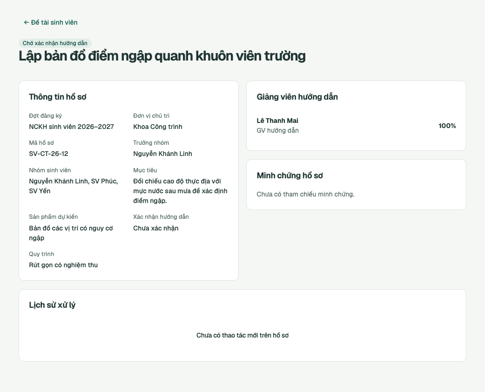
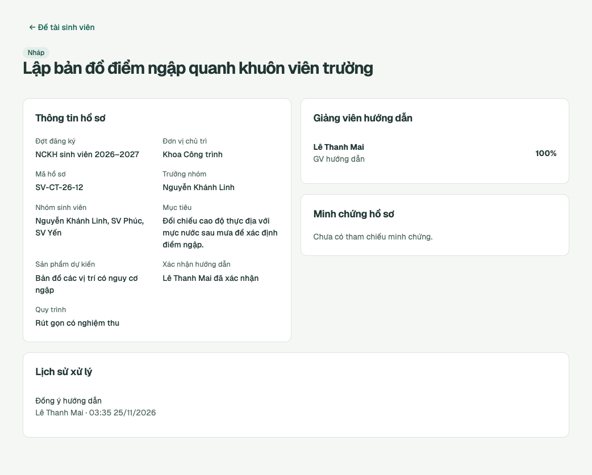

# Sinh viên theo dõi đăng ký và giảng viên xác nhận hướng dẫn

Các bước và ảnh dưới đây đã chạy lại trên bản mẫu v0 tại trường Thủy lợi. Dữ liệu thực hành được lưu trong trình duyệt.

1. Ở **Phiên mô phỏng**, chọn **Nguyễn Khánh Linh**. Mở **Đề tài sinh viên** và hồ sơ *Lập bản đồ điểm ngập quanh khuôn viên trường*. Đối chiếu trưởng nhóm, thành viên, mục tiêu, sản phẩm dự kiến và dòng **Xác nhận hướng dẫn**.

   

2. Chuyển sang phiên giảng viên **Lê Thanh Mai**. Mở đúng hồ sơ đó. Sau khi rà nội dung, chọn **Đồng ý hướng dẫn**, kiểm tên hồ sơ ở hộp thoại rồi xác nhận. Nếu nhóm cần sửa, chọn **Yêu cầu sửa đăng ký** và ghi lý do.

   

3. Quay lại phiên sinh viên và mở hồ sơ. Dòng **Lê Thanh Mai đã xác nhận** cho biết nhóm đã có xác nhận cho đúng đề tài. Chọn **Nộp đăng ký** khi đã rà đủ hồ sơ và đợt còn nhận.
