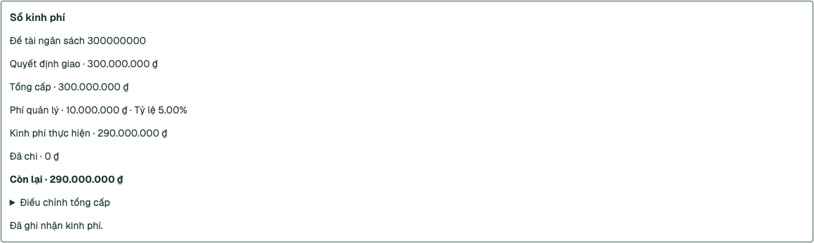
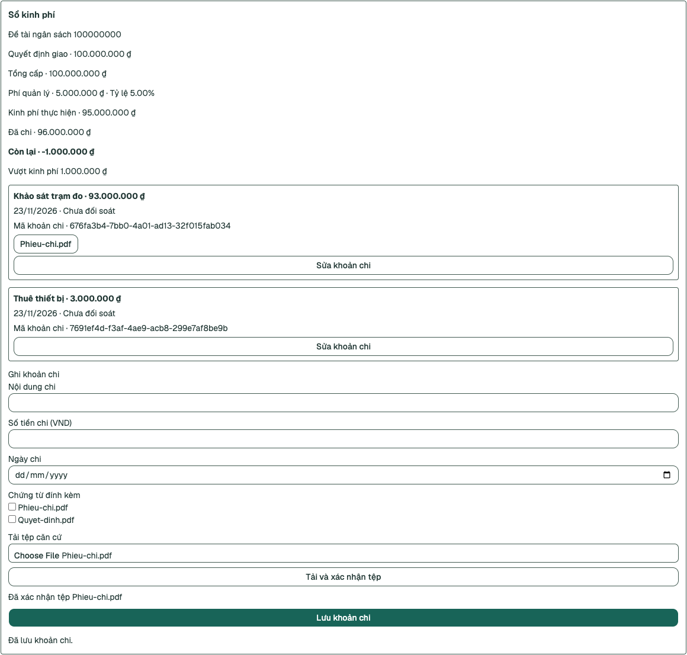
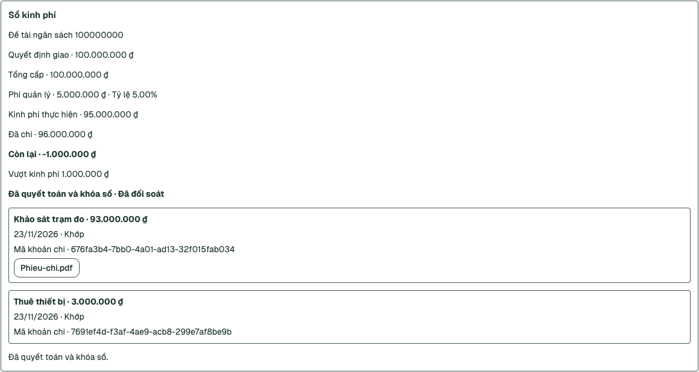

# Cấp kinh phí, ghi khoản chi và quyết toán

Mở **Hồ sơ nghiên cứu**, chọn đề tài rồi chọn **Kinh phí đề tài**. Số tiền trên sổ dùng đồng Việt Nam.

## Chuyên viên xác nhận cấp

1. Đối chiếu kinh phí trong quyết định giao. Kiểm tra trường **Tổng cấp (VND)** và chọn **Xác nhận cấp kinh phí**.
2. Kiểm tra tổng cấp, phí và kinh phí thực hiện. Ví dụ tổng cấp 300 triệu, tỷ lệ 5%, trần 10 triệu thì phần thực hiện là 290 triệu. Khi phải đổi phí riêng của đề tài, điền căn cứ vào **Lý do điều chỉnh**.
3. Nếu có quyết định điều chỉnh sau đó, mở **Điều chỉnh tổng cấp**. Nhập số mới và lý do. Sổ giữ phí đã xác nhận trừ khi người xử lý nhập phí điều chỉnh.

## Chủ nhiệm ghi chi

1. Điền nội dung, số tiền nguyên dương và ngày chi. Chọn chứng từ đã có hoặc tải tệp, sau đó chờ báo **Đã xác nhận tệp**.
2. Chọn **Lưu khoản chi**. Kiểm tra số đã chi và còn lại. Nếu vượt kinh phí, sổ vẫn ghi nhận khoản chi hợp lệ và hiển thị số vượt.
3. Để sửa khi đề tài đang thực hiện, chọn **Sửa khoản chi**. Nếu cần hủy, ghi lý do trước khi chọn **Hủy khoản chi**.

## Chuyên viên quyết toán

Sau khi đề tài nghiệm thu đạt, mở lại sổ. Nếu trường rà thủ công, đánh dấu **Đã rà soát thủ công** sau khi đối chiếu thực tế. Nếu trường bật đối soát, mở từng khoản, ghi mã giao dịch và số tiền thật. Đối chiếu các khoản báo **Chênh lệch** hoặc **Chưa đối soát**. Khi mọi khoản đã khớp, chọn **Quyết toán và đóng đề tài**. Kiểm tra dòng xác nhận đã khóa sổ.

