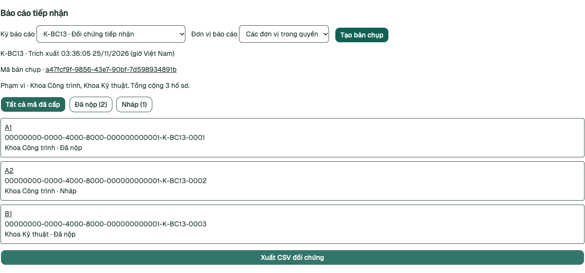
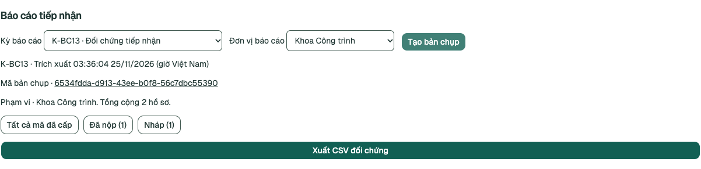

# Trưởng phòng và chuyên viên đối chiếu một kỳ

1. Đăng nhập đúng trường, mở **Báo cáo theo kỳ**. Chọn kỳ và đơn vị hoặc giữ **Các đơn vị trong quyền**. Tài khoản trưởng phòng trong ảnh được giao hai khoa.
2. Bấm **Tạo bản chụp**. Ghi **Mã bản chụp**, giờ trích xuất, phạm vi và tổng số hồ sơ vào phiếu. Mỗi đề tài đã cấp mã xuất hiện một lần, kể cả khi đang ở Nháp sau khi được trả bổ sung.
3. Chọn một nhóm trạng thái hoặc **Tất cả mã đã cấp**. Bấm tên đề tài để mở hồ sơ hiện hành. Dùng nút **Quay lại** của trình duyệt để đọc lại nhóm ở thời điểm trích xuất. Có thể sao chép liên kết **Mã bản chụp** để tự mở lại sau. Lượt mở lại kiểm quyền theo tài khoản hiện tại.
4. Chọn **Xuất CSV đối chứng**. So mã bản chụp trong tên tệp và trong bảng với mã trên màn hình. Dòng **Trích xuất (UTC)** tương ứng với giờ Việt Nam hiển thị trên web. Đối chiếu **Tổng số**, bảng **Trạng thái chuẩn / Số hồ sơ**, rồi so từng mã, khoa và định danh ở phần chi tiết với sổ tiếp nhận. Chọn **Tạo bản chụp** lần nữa để lấy số liệu mới sau khi chủ nhiệm nộp lại.
5. Nếu trường vừa thu hồi quyền xem một khoa, khi quay lại hoặc xuất bản cũ, RMS sẽ yêu cầu tạo bản chụp mới. Chọn kỳ và phạm vi còn được giao rồi bấm **Tạo bản chụp**. [Ảnh thông báo sau khi thu hẹp quyền](../../reviews/screenshots/report/ban-chup-thu-hep-quyen.png)
6. Khi nghiệm thu, trưởng phòng so từng mã, khoa và trạng thái giữa sổ tiếp nhận, màn hình và CSV ở cùng mốc. Ghi sai khác và ký kết luận theo quy trình của trường. [Phiếu đối chiếu US-13/T008](../../../e2e/report/call-report/review.md#phiếu-đối-chiếu-us-13t008-tại-trường)

## Mở báo cáo từ số liệu nhanh

Tại **Số liệu nhanh** trên trang chủ, chọn **Mở báo cáo theo kỳ**. Với chuyên viên hoặc trưởng phòng gắn một khoa, ô **Đơn vị báo cáo** chọn sẵn khoa đang dùng để tính số liệu trang chủ. Chọn kỳ rồi bấm **Tạo bản chụp**. Nếu cần đối chiếu tất cả khoa được giao, chọn **Các đơn vị trong quyền** và tạo bản chụp mới. Khi chưa được gắn khoa, chọn phạm vi trước khi tạo. Quản trị trường bắt đầu với tất cả đơn vị được phép xem.

Trong ví dụ, bản theo khoa có hai hồ sơ đã cấp mã. Cùng kỳ đó, khi trưởng phòng chọn cả hai khoa được giao, tổng là ba hồ sơ. Chọn **Về trang chủ** để quay lại.

