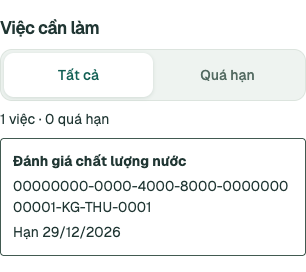
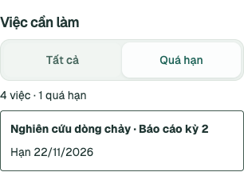
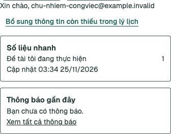
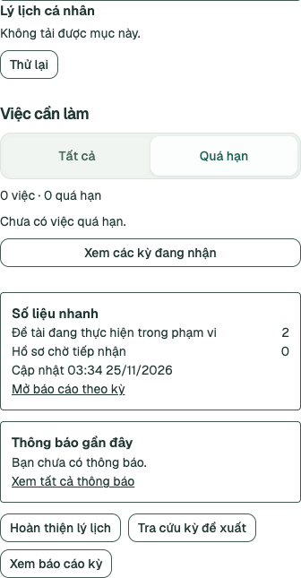

# Mở hồ sơ bị trả từ điện thoại

Đăng nhập đúng trường bằng tài khoản chủ nhiệm. Xem **Việc cần làm** ở trang tài khoản. Mỗi thẻ hiển thị tên đề tài, mã đã cấp và hạn bổ sung của kỳ. **Quá hạn** lọc những việc có hạn trước ngày hôm nay theo giờ Việt Nam.

Chạm tên đề tài để mở thuyết minh F01 và đọc lý do chuyên viên trả. Sửa nội dung, **Lưu nháp đề xuất**, rồi **Nộp đề xuất** trong thời gian kỳ còn nhận. Để tra cứu mà chưa sửa, dùng **Về danh sách việc**. Mở hoặc đọc hồ sơ giữ nguyên trạng thái.

Nếu quyền đã thay đổi từ lúc điện thoại tải danh sách, trang đích có thể báo “Công việc không còn trong phạm vi hiện tại”. Chọn **Về danh sách việc** để lấy danh sách theo quyền hiện hành.

## Mở báo cáo kỳ quá hạn

Ở **Việc cần làm**, chọn **Quá hạn**, rồi chọn thẻ ghi số kỳ. Trang **Giao đề tài và tiến độ** mở đúng kỳ của đề tài. Việc đến hạn hôm nay và phiếu chấm chưa có ngày chỉ xuất hiện khi chọn **Tất cả**.

## Đọc trang chủ theo vai trò

Ở **Số liệu nhanh**, xem số đề tài đang thực hiện và mốc cập nhật theo giờ Việt Nam. Chuyên viên cùng khoa có thể mở hồ sơ chờ tiếp nhận hoặc kỳ báo cáo chờ duyệt từ **Việc cần làm**. Sau khi xử lý, trở về trang chủ để đọc lại danh sách. Hạn nộp của chủ nhiệm chỉ dùng cho việc nộp báo cáo. Chọn một tin trong **Thông báo gần đây** để vào hộp thư. Quản trị trường có thể cấu hình các khối xuất hiện và thứ tự riêng cho từng vai trò.

## Xử lý nghiệm thu từ trang chủ

Chuyên viên chọn **Điều phối nghiệm thu** để mở hồ sơ của khoa. Thành viên hội đồng chọn **Chấm nghiệm thu** để mở phiếu cá nhân. Phiếu đã lưu nháp vẫn có trong **Tất cả**. Gửi xong, quay lại danh sách để thấy việc đã được gỡ. [Các bước chấm và chốt kết luận](san-pham-va-nghiem-thu.md#hội-đồng-chấm-và-chuyên-viên-chốt-kết-luận)

## Khi một mục báo lỗi

Nếu một thẻ hiện **Không tải được mục này**, bạn vẫn có thể mở công việc, báo cáo hoặc thông báo ở các thẻ đã tải. Chọn **Thử lại** trong thẻ lỗi khi muốn đọc lại mục đó. Nếu đang lọc **Quá hạn**, lựa chọn này vẫn được giữ. Khi cả trang báo **Chưa tải được trang chủ**, chọn **Thử tải trang chủ** để lấy lại bố cục của trường. Nếu hệ thống báo phiên hiện tại đã mất quyền truy cập, chọn **Đăng nhập lại**. Với tài khoản đã bị khóa, quản trị trường cần khôi phục quyền trước khi bạn có thể mở lại dữ liệu.

