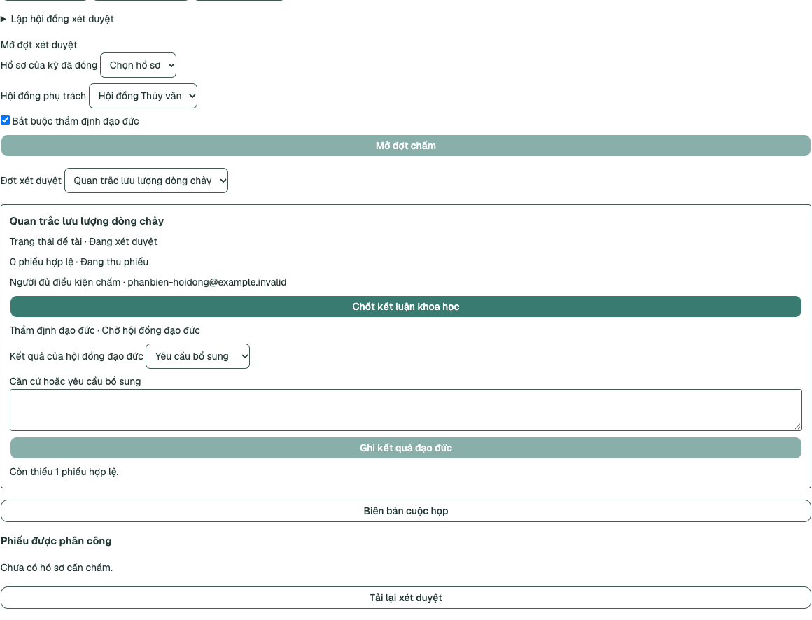
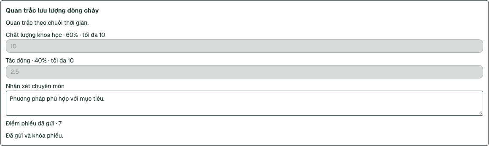
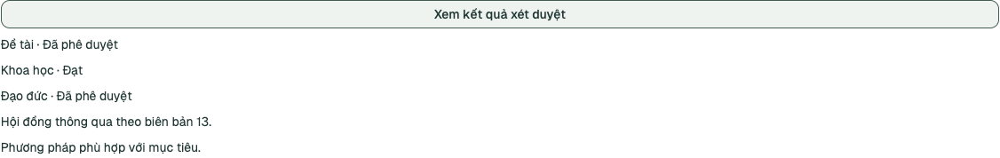
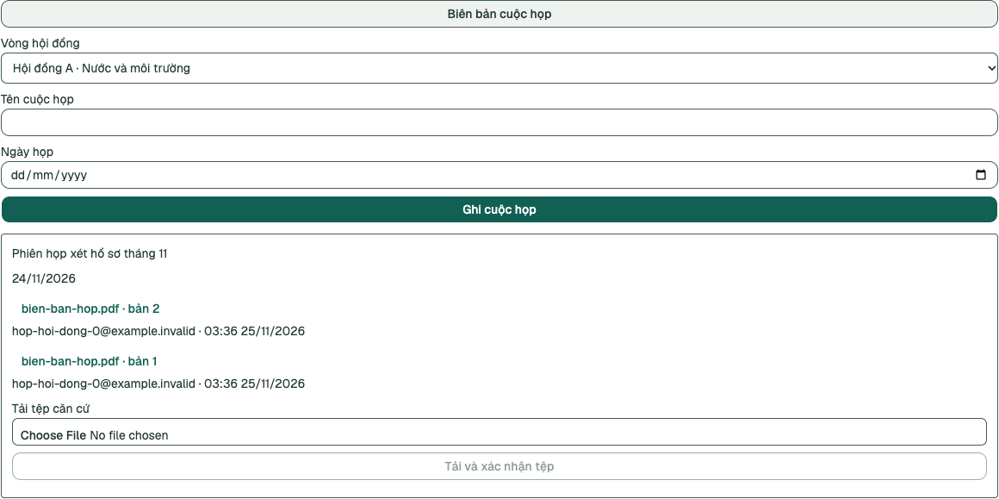

# Xét duyệt đề xuất theo vai trò

Áp dụng cho phiên đăng nhập tại `/app/<trường>`. Ảnh chụp từ Chrome ngày 24/11/2026 với tài khoản và hồ sơ thử. Trong ví dụ, đề tài **Quan trắc lưu lượng dòng chảy** cần thẩm định đạo đức.

## Chuyên viên mở đợt

1. Đóng kỳ nhận đề xuất tại **Kỳ nhận đề xuất**. Mở **Xét duyệt hội đồng → Lập hội đồng xét duyệt**, đặt tên, chọn người và chức danh rồi lưu.
2. Chọn hồ sơ thuộc kỳ đã đóng, đọc thuyết minh tại **Hồ sơ nghiên cứu** và bấm **Chốt hồ sơ hợp lệ** khi hồ sơ đủ điều kiện. Thao tác chốt danh sách vẫn giữ đề tài ở bước Đã nộp.
3. Chọn hội đồng phụ trách, xác nhận yêu cầu thẩm định theo quy chế của hồ sơ rồi bấm **Mở đợt chấm**. Hệ thống ghi người thực hiện và chuyển sang Đang xét duyệt. Danh sách người đủ điều kiện tự loại chủ nhiệm và thành viên đề tài.

## Thành viên hội đồng chấm phiếu

1. Vào **Xét duyệt hội đồng → Phiếu được phân công**. Đọc nội dung hồ sơ và các mức điểm tối đa.
2. Nhập điểm và nhận xét. **Lưu nháp phiếu** cho phép để trống tiêu chí. Khi đã nhập đủ, bấm **Gửi phiếu chấm**. Phiếu đã gửi được khóa. Nếu bạn vừa tham gia nhóm đề tài, hãy tải lại danh sách việc.
3. Ví dụ trong ảnh cho 10 điểm với trọng số 60% và 2,5 điểm với trọng số 40%. Hệ thống tính tổng bằng 7. Khi ghi nhận xét có thể công bố, tránh đưa tên hoặc thông tin nhận diện người chấm vào nội dung.

## Chuyên viên chốt và chủ nhiệm xem kết quả

Chuyên viên chọn đợt và bấm **Chốt kết luận khoa học**. Nếu thiếu phiếu, hệ thống nêu số còn thiếu. Khi đủ, kết quả lưu số phiếu, điểm trung bình, số phiếu tối thiểu và ngưỡng đang áp dụng. Quản trị viên cấu hình giá trị số cho `PROPOSAL_REVIEW.MIN_SUBMITTED_SCORE_SHEETS` và `PROPOSAL_REVIEW.PASSING_SCORE` tại B01.

Với hồ sơ có thẩm định đạo đức, chuyên viên nhập kết quả **đã được hội đồng quyết định**, ghi căn cứ hoặc nội dung yêu cầu bổ sung và bấm **Ghi kết quả đạo đức**. Khoa học đạt trong lúc chờ đạo đức vẫn giữ đề tài ở bước Đang xét duyệt.

Chủ nhiệm mở **Hồ sơ nghiên cứu → tên đề tài → Mở thuyết minh → Xem kết quả xét duyệt** để đọc bước hiện tại và căn cứ. Khi trường bật `PROPOSAL_REVIEW.PUBLIC_COMMENTS`, các nhận xét đủ điều kiện được hiển thị ẩn danh.

## Thư ký lập và bổ sung biên bản

1. Trong **Xét duyệt hội đồng**, mở **Biên bản cuộc họp**. Đối với vòng nghiệm thu, mở cùng mục trong **Phiếu nghiệm thu**.
2. Chọn đúng **Vòng hội đồng**. Thư ký điền tên, ngày rồi chọn **Ghi cuộc họp**. Mỗi cuộc họp có danh sách tệp và phiên bản riêng.
3. Trong đúng cuộc họp, chọn **Tải tệp căn cứ**, rồi **Tải và xác nhận tệp**. Để bổ sung phiên bản, gửi tệp mới và đối chiếu số bản, người ghi, thời điểm. Chọn bản cần đọc để tải.
4. Thành viên đủ điều kiện xem được các bản cũ của hội đồng mình. Khi hồ sơ hoặc phân công thay đổi, mở lại vòng để kiểm quyền hiện hành.

## Mở lại kết luận khoa học

1. Chuyên viên vào **Xét duyệt hội đồng**, chọn **Đợt xét duyệt** và đọc kết luận hiện tại.
2. Trong **Mở lại vòng hội đồng**, ghi lý do rồi chọn **Mở lại vòng**. Kiểm mục **Lịch sử điều chỉnh kết luận** để đối chiếu người thao tác, số phiếu, điểm và ngưỡng đã dùng. Các phiếu đã gửi vẫn giữ nguyên. [Ảnh lịch sử sau khi mở lại](../../reviews/screenshots/review/mo-lai-ket-luan.png)
3. Khi đã đối chiếu đủ phiếu, chọn **Chốt kết luận khoa học**. Nếu hệ thống báo vòng đã thay đổi, chọn lại đợt để đọc phiên bản hiện hành trước khi chốt.
4. Nếu hiện **Chuyển yêu cầu đính chính**, chọn chủ quy trình được trường ủy quyền, nhập lý do và bấm **Gửi yêu cầu đính chính**. Chủ quy trình đọc lý do trong hộp thông báo và xử lý theo quy chế.
