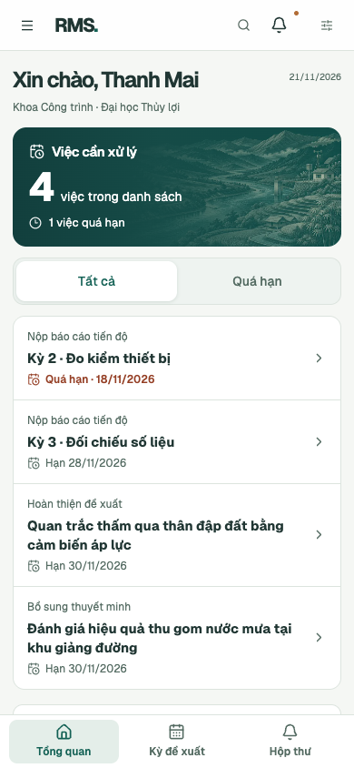
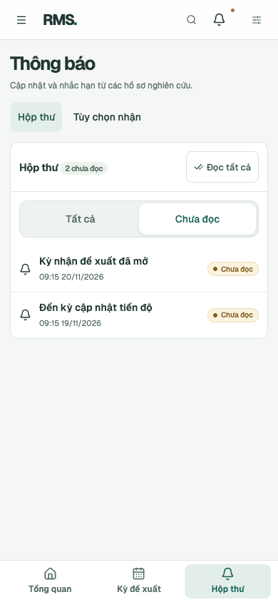
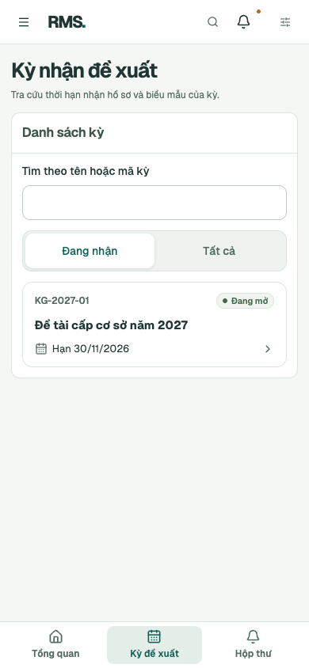

# RMS v0-mobile

Ưu tiên hai tình huống dễ bị gián đoạn trên điện thoại: chủ nhiệm tìm báo cáo đã quá hạn và người nhận đọc tiếp hộp thư từ chỗ dừng. Tình huống thứ ba phục vụ đầu kỳ: đối chiếu mã và hạn nhận trong công văn trước khi chuẩn bị thuyết minh. Cả ba đã có bản tương tác trong web RMS và có thể thử riêng từ B06, B04 hoặc F02. [Backlog INVEST và ước lượng](../product/mobile-invest.md) · [Biên bản Spec Kit](../../specs/workflow-run.md)

## Căn cứ lựa chọn

Đợt này là nghiên cứu tài liệu và khảo sát ứng dụng hiện hành. Nguồn nội bộ gồm personas, quyết định pilot, BR/AC của ba module, bộ fixture và giao diện v0 trước thay đổi ở commit 3949a2b. Mức ưu tiên là nhận định sản phẩm để đem thử. Repo ghi nhận nhu cầu mở việc trên điện thoại của chủ nhiệm. Tần suất sử dụng thực tế và mức tiết kiệm thời gian cần đo với người dùng của trường. [Personas RMS](../product/personas.md) · [RV-34](../../specs/review-decisions.md#rv-34) · [Rà soát v0 trước đợt mobile](rms-v0-frontend.md)

| Quan sát | Hàm ý cho RMS | Quyết định thiết kế |
|---|---|---|
| B06 đã có thẻ mở hồ sơ. Trên v0 cũ, người dùng phải so ngày giữa các thẻ vì nhãn Quá hạn bị ẩn ở màn hình nhỏ. | Biết hồ sơ nào phải làm trước là một kết quả riêng, kiểm được bằng hai kỳ báo cáo của cùng một đề tài. | Đặt số việc quá hạn và bộ lọc ngay trên danh sách của widget việc. Một chạm để lọc, một chạm để sang F04. [US-12](../../specs/012-mobile-open-work-item/spec.md) · [B06](../features/B06-trang-chu/spec.md) |
| B04 yêu cầu đánh dấu đã đọc khi người nhận mở tin. V0 cũ dùng một lựa chọn lọc trong bộ nhớ của màn hình. | Người dùng có thể quay lại một hộp thư đầy đủ sau khi chỉ muốn xử lý tin mới. | Lưu bộ lọc trong đường dẫn danh sách. Đọc một tin chỉ cập nhật tin đó. [B04 AC-06](../features/B04-thong-bao/spec.md) |
| F02 có tên, mã, khoảng nhận và trạng thái trong bốn cột. Grants.gov cũng hỗ trợ tìm cơ hội theo mã ghi trong thông báo. | Khi người dùng đã biết mã, đường ngắn nhất là nhập mã rồi đối chiếu ngày. | Thẻ kỳ cho thấy mã, tên, trạng thái và hạn cùng lúc. Chi tiết dùng quy tắc tiếp nhận và biểu mẫu sẵn có. [F02](../features/F02-dot-keu-goi/spec.md) · [Grants.gov – hướng dẫn cho người nộp](https://www.grants.gov/quick-start-guide/applicants) |
| eRA Commons cho chủ nhiệm xem hồ sơ theo phạm vi và mở chi tiết từ mã hồ sơ. | Danh sách rút gọn vẫn cần một đích nghiệp vụ xác định và có quyền truy cập. | B06 chuyển tới đề tài chứa kỳ báo cáo. F02 chuyển theo id kỳ. Quyền hệ thống đích do backend kiểm tra. [NIH eRA Commons – Status for PIs](https://www.era.nih.gov/erahelp/commons/Commons/status/Status_PI.htm) |
| WCAG 2.2 mô tả reflow ở 320 CSS px và tiêu chí kích thước mục tiêu 24 CSS px có ngoại lệ. | Kiểm riêng cuộn ngang và vùng chạm. | Bản mẫu dành tối thiểu 44 CSS px chiều cao cho nút lọc và các mục điều hướng nhanh. 44 px là mục tiêu thiết kế của RMS. [W3C – Reflow](https://www.w3.org/WAI/WCAG22/Understanding/reflow.html) · [W3C – Target Size](https://www.w3.org/TR/WCAG22/#target-size-minimum) |

Mốc lọc hiện dùng ngày nghiệp vụ **21/11/2026** của bộ dữ liệu v0. Khi chọn Quá hạn, việc có hạn 18/11 xuất hiện, việc hạn hôm nay và việc chưa có hạn nằm ở Tất cả. Ngày cố định giúp người duyệt chạy lại cùng ví dụ. Thiết kế sản xuất dùng ngày hiện hành theo Asia/Ho_Chi_Minh. [Luật ngày của fixture](../../apps/web/src/features/intake/model.ts) · [RV-38](../../specs/review-decisions.md#rv-38)

Các tác vụ nộp thuyết minh dài, đối chiếu kinh phí và vận hành kỳ đã có luồng web tương ứng. Đề xuất pilot trước mắt là quan sát xem người dùng có tiếp tục các tác vụ này từ danh sách trên điện thoại hay chuyển sang máy tính. Quyết định RV-34 đặt điều kiện riêng cho push, làm việc ngoại tuyến và ứng dụng native: cần hai đơn vị xác nhận cùng nhu cầu và có phương án quản lý, thu hồi dữ liệu trên thiết bị. [Backlog gốc](../sales/thi-truong-viet-nam-2026/feature-list-invest.md) · [ADR-0014](../architecture/decisions/0014-kenh-san-pham-va-ke-hoach-invest.md)

## Backlog và hồ sơ Spec Kit

| Lát / độ ưu tiên | Module sở hữu | Phép thử giá trị | Hồ sơ giao việc |
|---|---|---|---|
| US-33 · P1 · 2 điểm | B06 / home, E0 | Trong bốn việc của Mai, tìm kỳ 2 có hạn 18/11 và mở đúng đề tài ở F04. Dữ liệu và nhật ký đề tài giữ nguyên. | [Spec](../../specs/033-mobile-triage-deadlines/spec.md) · [Plan](../../specs/033-mobile-triage-deadlines/plan.md) · [Tasks](../../specs/033-mobile-triage-deadlines/tasks.md) |
| US-34 · P1 · 3 điểm | B04 / notification, E0 | Từ hai tin mới, mở một tin, quay lại và tải lại. Còn một tin trong bộ lọc. Cùng mã ở trường thứ hai vẫn có trạng thái đọc riêng. | [Spec](../../specs/034-mobile-read-inbox/spec.md) · [Plan](../../specs/034-mobile-read-inbox/plan.md) · [Tasks](../../specs/034-mobile-read-inbox/tasks.md) |
| US-35 · P2 · 2 điểm | F02 / call, E1 | Tra KG-2027-01, đối chiếu hạn 30/11 và biểu mẫu. Người quản lý có thể chuyển sang toàn bộ kỳ thuộc phạm vi. | [Spec](../../specs/035-mobile-find-open-call/spec.md) · [Plan](../../specs/035-mobile-find-open-call/plan.md) · [Tasks](../../specs/035-mobile-find-open-call/tasks.md) |

Mỗi thẻ hoàn tất **specify → clarify → plan → tasks** trước khi bắt đầu thẻ kế tiếp. Clarify ghi câu hỏi, căn cứ, khuyến nghị và người duyệt. Mỗi plan có nghiên cứu, mô hình dữ liệu, hợp đồng hành vi và quickstart. Mỗi lát có bốn AC, bốn TC đối ứng, ánh xạ màn hình và bảy task theo phụ thuộc. Trong 21 task, ba task chuẩn bị fixture đã có bằng chứng ở v0. Mười tám task còn lại phục vụ hợp đồng, kiểm quyền máy chủ, tích hợp và nghiệm thu hệ thống đích. [Biên bản chạy theo từng lát](../../specs/workflow-run.md) · [Sổ quyết định RV-38–40](../../specs/review-decisions.md#rv-38)

## Xem và dùng bản mẫu

Chạy tại gốc repo với Node và pnpm theo cấu hình dự án.

```sh
corepack pnpm install --frozen-lockfile
corepack pnpm dev
```

Mở **/v0-mobile/** trên địa chỉ Vite. Desktop hiện khung rộng 390 CSS px. Trên điện thoại, mở cùng đường dẫn hoặc trang chủ RMS để dùng toàn màn hình. Tại chiều rộng tới 600 CSS px, thanh dưới mở Tổng quan, Kỳ đề xuất và Hộp thư theo quyền. Menu trên cùng mở các chức năng còn lại. Nút **Phiên mô phỏng** cho đổi người hoặc trường. [Điểm vào ứng dụng](../../apps/web/src/App.tsx) · [Cấu hình shadcn](../../apps/web/components.json)

| B06 · Việc của chủ nhiệm | B04 · Hai tin chưa đọc | F02 · Kỳ còn nhận hồ sơ |
|---|---|---|
|  |  |  |

Bản mẫu dùng React/Vite và component shadcn/ui chung của monorepo: Button cho bộ lọc, Input cho tìm mã kỳ, Badge cho trạng thái và Empty cho danh sách rỗng. Thiết kế giữ font Geist tiếng Việt và màu của RMS. Bộ lọc có trạng thái đọc được bằng công nghệ hỗ trợ, hàng có thể chạm toàn bộ, quá hạn được ghi bằng chữ, thanh dưới dành khoảng trống cho nội dung cuối trang. Phần chọn tác vụ, thiết kế và xác minh dùng các skill brainstorming, Spec Kit, frontend-design, ui-ux-pro-max, shadcn, TDD và webapp-testing. [Thành phần mobile](../../apps/web/src/features/mobile/) · [Thư viện UI](../../packages/ui/src/components/)

## Kiểm chứng và phạm vi bằng chứng

| Phép kiểm | Kết quả / ý nghĩa |
|---|---|
| Kiểu, lint, bản build | TypeScript của web và UI, ESLint và Vite production build đều thành công. |
| Luật miền dùng chung | 67/67 ca đạt. Bao gồm quyền nguồn, chuyển bước đề tài, kỳ nhận và báo cáo. |
| Giao diện v0 | 22/22 ca Playwright đạt trên Chrome. Gồm 6 luồng v0 có sẵn và 16 ca bổ sung. Ba luồng chính chạy ở 320, 360 và 390 CSS px. Sáu ca biên chạy ở 360 và 390 px. Một ca kiểm khung preview desktop và mở tiếp cùng màn hình ở kích thước đầy đủ. |
| Hồi quy nền tảng | 6/6 ca Chrome B01/P01 đạt, gồm cấu hình bố cục vai trò áp vào F02 và B06. |
| Rà bố cục | Ba ảnh 390 × 844 ở trên lấy từ ứng dụng chạy thật. Bộ E2E đo cuộn ngang toàn trang và kích thước các mục thanh dưới trên ba tuyến chính. |

Hai bộ fixture có thể cùng dùng mã thông báo. Lượt thử đổi trường phát hiện route chi tiết cũ còn tồn tại trong lần render đầu của phiên mới và làm một tin bị đánh dấu đã đọc. Việc chuyển phiên nay đặt route B06 cùng lúc với dữ liệu của phiên. Ca hồi quy đối chiếu số chưa đọc và nội dung của hai người, hai trường. [Chuyển phiên](../../apps/web/src/App.tsx) · [Ca thử tự động](../../e2e/v0/mobile.spec.ts)

Để chạy lại từ gốc repo sau khi cài phụ thuộc E2E, dùng các lệnh sau. Lượt bàn giao dùng Node 24.21.0, pnpm 10.34.5, Playwright 1.61.1 và kênh Chrome đã cài. [Cấu hình E2E cục bộ](../../e2e/playwright.v0.config.ts)

```sh
corepack pnpm lint
corepack pnpm test
corepack pnpm build
RMS_BROWSER_CHANNEL=chrome npm --prefix e2e run test:v0
```

## Quyết định cho pilot

PO/BA có thể dùng bản này cho buổi thử có hướng dẫn với chủ nhiệm và chuyên viên QLKH. Dữ liệu ở trình duyệt là dữ liệu giả lập. Kiểm quyền phía máy chủ, giao dịch đồng thời nhiều người dùng và xác nhận trên điện thoại vật lý thuộc bước pilot tiếp theo. [Hợp đồng B06](../../specs/033-mobile-triage-deadlines/contracts/interaction.md) · [Hợp đồng B04](../../specs/034-mobile-read-inbox/contracts/interaction.md) · [Hợp đồng F02](../../specs/035-mobile-find-open-call/contracts/interaction.md)

| Ai thử | Bài giao, không chỉ vị trí nút | Ghi nhận để ra quyết định |
|---|---|---|
| Chủ nhiệm có nhiều kỳ báo cáo | “Tìm kỳ đã trễ và mở đề tài chứa kỳ đó.” | Mã kỳ, ngày hạn, số lần chạm tới hồ sơ. Mục tiêu đề xuất là chọn đúng trong hai lần chạm từ B06. |
| Người vừa nhận hai tin | “Đọc tin mở kỳ. Quay lại và cho biết còn tin nào cần đọc.” | Tin còn lại, số đếm sau khi quay lại, trường hợp vô tình chọn đọc tất cả. |
| Nhà khoa học và chuyên viên | “Từ mã trên công văn, cho biết hạn và biểu mẫu. Với vai trò quản lý, tìm thêm kỳ nháp.” | Hạn, tên mẫu, người có thể nhìn thấy bản nháp, thao tác cần hỗ trợ. |

UX ghi thiết bị, trình duyệt, kết quả quan sát và phản hồi theo từng người. PO/BA dùng các kết quả đó để duyệt bộ lọc hạn, cách quay lại hộp thư và nhóm kỳ mặc định. Tại buổi rà ngày 22/11, ba quyết định còn chờ review. Ngày 24/11, BA/PO đã chốt cả ba cho triển khai. Phép thử trên thiết bị vật lý vẫn thuộc pilot. [RV-38](../../specs/review-decisions.md#rv-38) · [RV-39](../../specs/review-decisions.md#rv-39) · [RV-40](../../specs/review-decisions.md#rv-40)

## Đối chiếu F02 trên backend ngày 24/11/2026

US-35 đã chạy với hai realm và phiên OTP thật trên Chrome local, ở 320/360/390 px. Chuyên viên thấy kỳ nháp trong Tất cả; tác giả không thấy. Lọc mã, hạn, biểu mẫu, hành động lập đề xuất và trạng thái rỗng khớp nguồn. Ca DB bao quát hai đầu ngày nghiệp vụ cho kỳ tương lai/hết hạn. [Bằng chứng US-35](../../specs/035-mobile-find-open-call/quickstart.md)

### US-34 trên hệ thống tích hợp

Hai phiên chủ nhiệm độc lập ở 360/390 px và phiên đối chứng desktop khác trường. Bộ lọc, số chưa đọc sau Back/reload, quyền theo ID và mở lại đạt cả bốn ca ngày 24/11/2026. [Bằng chứng](../../e2e/notification/deadline-reminder/review.md) · [Hướng dẫn có ảnh](../guides/nguoi-dung/hop-thong-bao.md)

### US-33 trên hệ thống tích hợp

Ở 360/390 px, B06 hiển thị ba kỳ F04 và một phiếu F03 chưa có hạn của cùng người. Lọc Quá hạn chỉ còn kỳ 2; vào F04 và quay lại giữ nguyên số audit. Sau khi quản trị bỏ tasks ở B01, API dừng trả cả thẻ và số đếm. Bộ tích hợp đạt 15/15. [Ca kiểm](../../e2e/home/triage-deadlines/acceptance.spec.ts)
