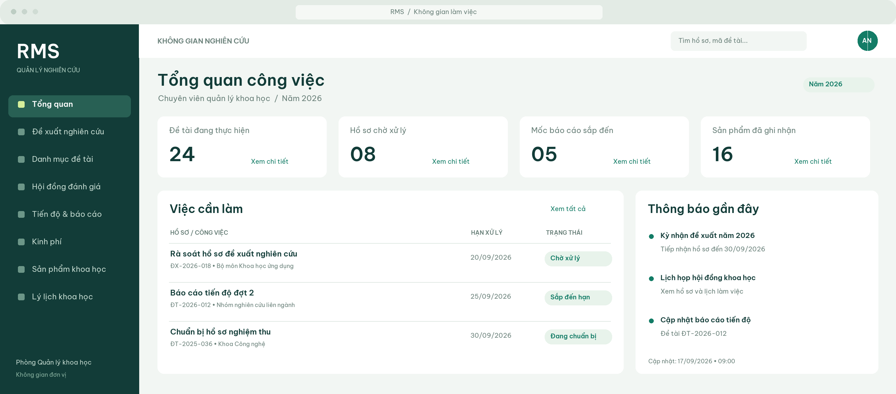

# RMS | Giới thiệu sản phẩm

**Hệ thống Quản lý Nghiên cứu Khoa học** (Research Management System) giúp phòng quản lý khoa học theo dõi một đề tài từ lần nộp đầu đến khi đóng hồ sơ. Với cùng một mã đề tài, chuyên viên có thể tìm lại lý do trả hồ sơ, kết luận hội đồng, tiến độ, các khoản chi và sản phẩm đã được công nhận.

## Một kỳ xét duyệt ở trường đại học

Khi nhận thuyết minh qua email, chuyên viên phải ghép các lần nộp để biết bản nào cần đưa ra hội đồng. Nếu đếm từng lượt gửi, một hồ sơ bổ sung có thể xuất hiện hai lần trong báo cáo kỳ. RMS cấp mã khi chủ nhiệm nộp lần đầu và giữ nguyên mã khi nộp lại.

| Người sử dụng | Họ cần biết gì? | RMS hỗ trợ như thế nào? |
|---|---|---|
| Chủ nhiệm đề tài | Hồ sơ đang ở đâu, còn thiếu gì? | Xem lý do trả, sửa thuyết minh và nộp lại trong hạn. Trên điện thoại, mở việc cần làm để tới đúng hồ sơ. |
| Chuyên viên quản lý khoa học | Hồ sơ nào cần xử lý, mốc nào sắp đến? | Mở kỳ, rà hồ sơ, tổ chức chấm, theo dõi kết luận và lịch báo cáo của các đề tài trong phạm vi phụ trách. |
| Thành viên hội đồng | Tôi được chấm hồ sơ nào, theo tiêu chí nào? | Mở hồ sơ được phân công, nhận xét và gửi phiếu theo bộ tiêu chí của đợt. |
| Lãnh đạo phòng hoặc đơn vị | Con số của kỳ gồm những đề tài nào? | Xem báo cáo trong phạm vi được cấp quyền, đối chiếu số tổng với danh sách mã cùng thời điểm. |

## Từ kết luận hội đồng đến kết quả nghiên cứu

**Ví dụ minh họa.** Một nhóm cam kết giao một bài báo. Sau khi đề xuất được duyệt, chuyên viên ghi nhận quyết định giao đề tài, thời gian và kinh phí. Chủ nhiệm nộp báo cáo theo kỳ, ghi các khoản chi và kê khai bài báo kèm minh chứng.

| Mốc | Kết quả người dùng nhìn thấy |
|---|---|
| Chuẩn bị nghiệm thu | Báo cáo cuối kỳ đã đạt. Nếu bài báo còn chờ duyệt, chuyên viên thấy loại sản phẩm còn thiếu để hướng dẫn nhóm hoàn thiện. |
| Nghiệm thu đạt | Hội đồng có kết luận về kết quả khoa học. Chuyên viên còn một việc riêng là rà kinh phí và quyết toán trước khi đóng đề tài. |
| Lập lý lịch khoa học | Bài báo đã duyệt xuất hiện trong lý lịch của tác giả cùng vai trò tham gia đề tài. Trường có thể trích lý lịch theo mẫu của mình. |

### Phạm vi thử đầu tiên

Theo lộ trình đề xuất, trường chọn **một kỳ đề tài cấp cơ sở và hai đơn vị tham gia**. Phòng khoa học chuẩn bị biểu mẫu, tiêu chí và danh sách của kỳ gần nhất. Lượt thử đầu đi từ mở kỳ, nộp, bổ sung, chấm đến báo cáo theo kỳ. Đợt tiếp theo mới nối việc giao đề tài, theo dõi tiến độ, kinh phí và nghiệm thu.

**Cách đánh giá.** Ghi thời gian từ nộp đến kết luận, tỷ lệ hồ sơ phải bổ sung và thời gian lập báo cáo. Tại cùng mốc chốt, so số tổng với danh sách mã mà từng đơn vị được xem. Các phép đo này giúp trường quyết định có mở rộng sau kỳ thử hay không.

Đề tài sinh viên, quy đổi giờ giảng và trợ lý AI là các lựa chọn bật riêng theo trường. Kết nối kế toán để đối soát tự động cần có đối tác, dữ liệu mẫu và đầu mối chịu trách nhiệm.

**Tài liệu liên quan** · [Mô tả giải pháp chi tiết](rms-mo-ta-giai-phap-chi-tiet.md) · [Tầm nhìn sản phẩm](../product/vision.md) · [Lộ trình theo kỳ](../product/roadmap.md)
