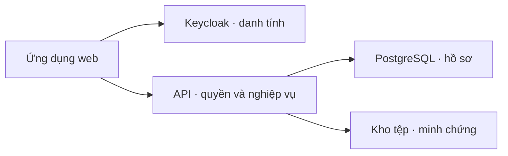

# RMS | Mô tả giải pháp chi tiết

Hệ thống Quản lý Nghiên cứu Khoa học (RMS) dùng hồ sơ đề tài làm đầu mối cho nhà nghiên cứu, phòng quản lý khoa học và hội đồng. Tài liệu mô tả thiết kế đích, các quy tắc bàn giao giữa các bước và cách trường có thể kiểm chứng giải pháp trong một kỳ thử.

## 1. Hồ sơ nào đi cùng đề tài?

Một kỳ nhận nhiều đề xuất. Mỗi đề xuất có một chủ nhiệm, có thể có nhiều thành viên và nhận mã đề tài khi nộp lần đầu. Từ mã đó, chuyên viên tra được các quyết định và minh chứng liên quan. Quyền xem từng phần phụ thuộc vai trò, đơn vị và quan hệ của người dùng với hồ sơ.

| Hồ sơ nghiệp vụ | Liên kết cần giữ | Câu hỏi trả lời được |
|---|---|---|
| Kỳ và thuyết minh | Kỳ, biểu mẫu, đề tài, chủ nhiệm và thành viên | Nhóm đã nộp theo mẫu nào? Hồ sơ bị trả vào lần nào, vì lý do gì? |
| Hội đồng và phiếu chấm | Đề tài, đợt đánh giá, hội đồng, người chấm và bộ tiêu chí | Kết luận dựa trên những phiếu đã gửi của đợt nào? |
| Quyết định giao và thực hiện | Đề tài, căn cứ giao, kinh phí được duyệt, lịch và từng báo cáo | Thời hạn nào đã cam kết? Kỳ nào còn thiếu báo cáo? |
| Kinh phí và sản phẩm | Đề tài nguồn, khoản chi, chứng từ, đầu ra, tác giả và minh chứng | Khoản chi thuộc đề tài nào? Có đủ sản phẩm đã duyệt theo từng loại cam kết chưa? |
| Lý lịch và báo cáo | Người nghiên cứu, vai trò, đầu ra đã duyệt, phạm vi truy cập | Thành tích nào được đưa vào lý lịch? Số đề tài của đơn vị gồm những mã nào? |

**Hai hồ sơ dễ nhầm.** Phiếu xét duyệt cho biết đề tài có được chấp thuận để giao thực hiện. Phiếu nghiệm thu đánh giá kết quả thực tế vào cuối kỳ. Hai bước dùng chung mô hình hội đồng nhưng có đợt chấm, tiêu chí và kết luận riêng.

**Căn cứ** · [Mô hình dữ liệu và vòng đời](../architecture/data-model.md) · [Thuật ngữ RMS](../product/glossary.md)

## 2. Mở kỳ, tiếp nhận và xét duyệt

### Mở kỳ và trả bổ sung

Chuyên viên chọn thời gian nhận hồ sơ, lĩnh vực, mẫu thuyết minh và bộ tiêu chí còn hiệu lực (F02). Khi đã có hồ sơ nộp, các lựa chọn làm căn cứ cho hồ sơ được khóa theo đặc tả của kỳ. Chuyên viên có thể gia hạn ngày kết thúc nhận đề xuất.

Chủ nhiệm điền thuyết minh, khai thành viên, kinh phí đề xuất và đính kèm hồ sơ (F01). Khi nộp, hệ thống kiểm kỳ còn mở, còn hạn và đủ các trường bắt buộc. Lần nộp đầu sinh mã và khóa nội dung. Trong hạn, chuyên viên có thể trả về nháp kèm lý do. Chủ nhiệm sửa rồi nộp lại với cùng mã.

### Hội đồng kết luận trên căn cứ nào?

| Bước | Người thực hiện và điều kiện | Kết quả |
|---|---|---|
| Mở đợt xét | Chuyên viên chọn hồ sơ đã nộp, lập hội đồng xét duyệt có thành viên và dùng bộ tiêu chí của kỳ. | Hồ sơ chuyển sang đang xét duyệt. |
| Gửi phiếu | Thành viên được phân công chấm đủ tiêu chí trong thang điểm. Chủ nhiệm và thành viên đề tài bị loại khỏi việc chấm đề tài đó. | Mỗi người chấm có tối đa một phiếu trong một đợt. |
| Kết luận | Khi đủ số phiếu đã gửi, hệ thống tổng hợp điểm theo trọng số và ngưỡng của đợt. Chuyên viên thực hiện bước kết luận. | Lưu kết quả và khóa phiếu. Mở lại đợt cần lý do và được ghi nhật ký. |

**Trường hợp cần thẩm định đạo đức.** Với đề tài thuộc diện này, phương án chờ duyệt RV-11 là lưu kết luận khoa học riêng và chỉ chuyển đề tài sang đã duyệt khi đạt cả yêu cầu đạo đức. Phòng khoa học và thư ký hai hội đồng cần xác nhận điểm chặn trước kỳ thử.

**Đối chiếu báo cáo kỳ.** Ví dụ có ba hồ sơ đã cấp mã, một trong ba hồ sơ nộp hai lần, cùng một bản nháp chưa từng nộp. Theo phương án RV-13, tổng cả kỳ là ba. Bảng chi tiết và số tổng phải lấy cùng tập mã tại thời điểm trích xuất, trong cùng phạm vi quyền.

**Căn cứ** · [F02 · Mở kỳ](../features/F02-dot-keu-goi/spec.md) · [F01 · Nộp hồ sơ](../features/F01-de-xuat-de-tai/spec.md) · [F03 · Hội đồng](../features/F03-xet-duyet-hoi-dong/spec.md) · [RV-11 và RV-13](../../specs/review-decisions.md)

## 3. Thực hiện, nghiệm thu và đóng đề tài

| Mốc | Ai làm gì? | Điều kiện bàn giao |
|---|---|---|
| Giao đề tài (F04) | Chuyên viên lập hồ sơ giao từ đề tài đã duyệt, ghi căn cứ, thời gian, kinh phí và đính quyết định hoặc hợp đồng. | Khi hồ sơ giao có hiệu lực, đề tài mới chuyển sang đang thực hiện và có thể lập lịch báo cáo. |
| Báo cáo tiến độ (F04, B04) | Chủ nhiệm nộp theo kỳ. Chuyên viên duyệt đạt hoặc yêu cầu chỉnh sửa kèm nhận xét. B04 nhắc theo hạn cấu hình. | Nộp muộn được ghi nhận là trễ. Kỳ cuối phải đạt trước khi chuyển sang chờ nghiệm thu. |
| Kinh phí (F05) | Chuyên viên xác nhận tổng cấp trong mức được duyệt. Chủ nhiệm ghi khoản chi của đề tài mình và đính chứng từ. | So tổng chi với kinh phí thực hiện sau phí quản lý. Bản đơn giản cảnh báo và vẫn cho ghi khoản vượt. |
| Sản phẩm (F07) | Tác giả hoặc chủ nhiệm kê khai loại, tác giả, năm, thông tin công bố và minh chứng. Chuyên viên duyệt hoặc trả kèm lý do. | Đếm sản phẩm đã duyệt, gắn đúng đề tài, theo từng loại và số lượng cam kết. |
| Nghiệm thu (F06) | Khi kỳ cuối đạt và đủ đầu ra, chuyên viên mở đợt với hội đồng, tiêu chí và phiếu nghiệm thu riêng. | Đủ phiếu mới kết luận. Nếu cho làm lại, chuyên viên ghi lý do, hạn và kiểm tra giới hạn số lần. |
| Quyết toán và lý lịch (F05, F08) | Sau nghiệm thu đạt, chuyên viên rà kinh phí và thực hiện quyết toán. F08 tổng hợp vai trò và sản phẩm đã duyệt theo tác giả. | Quyết toán đưa đề tài sang hoàn thành và khóa số liệu kinh phí. Có thể trích lý lịch theo mẫu trường. |

**Ví dụ về phí quản lý.** Giả sử trường áp dụng 5%, tổng cấp 100 triệu đồng, không áp trần và giữ nguyên mức phí tính ra. Phí quản lý là 5 triệu, kinh phí thực hiện là 95 triệu. Nếu tổng chi lên 96 triệu, chuyên viên thấy mức vượt 1 triệu đồng để rà với chủ nhiệm.

**Điểm cần thống nhất khi khóa sổ (RV-24).** Trong đợt thử, F05 dự kiến chuyên viên rà thủ công. Khi có dữ liệu đối soát, F06 yêu cầu xử lý khoản còn chênh trước khi đóng. Chủ sản phẩm, phòng khoa học và kế toán trưởng cần chốt điều kiện áp dụng cho trường.

**Căn cứ** · [F04 · Tiến độ](../features/F04-quan-ly-tien-do/spec.md) · [F05 · Kinh phí](../features/F05-quan-ly-kinh-phi/spec.md) · [F06 · Nghiệm thu](../features/F06-nghiem-thu/spec.md) · [F07 · Sản phẩm](../features/F07-san-pham-khoa-hoc/spec.md) · [F08 · Lý lịch](../features/F08-ly-lich-khoa-hoc/spec.md)

## 4. Kiến trúc đích và đường đi của dữ liệu

Mọi vai trò dùng chung một ứng dụng web thích ứng với máy tính và điện thoại. Trang chủ B06 chỉ đọc, hiển thị việc cần làm và dẫn người dùng sang chức năng chịu trách nhiệm. Chẳng hạn, chạm vào thẻ “Hồ sơ cần bổ sung” sẽ mở F01. F01 kiểm lại quyền và tình trạng của kỳ trước khi nhận thay đổi.

| Thành phần | Trách nhiệm trong thiết kế đích |
|---|---|
| Web và định danh | Web React kết nối Keycloak. Mỗi trường có một miền định danh (realm). Người dùng xác thực bằng mã dùng một lần qua email. RMS quản lý quyền nghiệp vụ ở B03 và kiểm quyền trên máy chủ với mọi API. |
| API và dịch vụ miền | API NestJS tổ chức theo phân hệ. Hợp đồng OpenAPI trong `packages/api-contracts` ở kho mã triển khai là nguồn sinh kiểu cho các bên. P01 thực hiện chuyển trạng thái đề tài sau khi kiểm vai trò, bước hiện tại và điều kiện nghiệp vụ. |
| Cơ sở dữ liệu và lịch sử | PostgreSQL lưu quan hệ giữa hồ sơ, kỳ, đợt chấm và kết quả. Chuyển trạng thái thành công ghi lịch sử quy trình và nhật ký P02 chỉ cho ghi thêm, trong cùng giao dịch. Nếu giao dịch thất bại, các thay đổi cùng được hoàn tác. |
| Kho tệp | Thuyết minh, chứng từ và minh chứng nằm trong kho riêng tương thích S3. Cơ sở dữ liệu giữ thông tin mô tả và liên kết. API kiểm quyền đối với hồ sơ trước khi cấp đường dẫn tải có thời hạn. |
| Thông báo và tích hợp | B04 lưu thông báo trong ứng dụng. Tiến trình nền gửi email hoặc SMS theo sự kiện và cấu hình. Nếu cổng gửi gặp lỗi, thông báo trong ứng dụng vẫn có thể tra cứu. Kết nối kế toán là hạng mục sau thử nghiệm. |

**Dữ liệu của từng trường.** Một trường hoặc tổ chức sử dụng RMS là một tenant. Phương án v0 đề xuất dùng chung PostgreSQL, đặt ngữ cảnh tenant cho từng giao dịch và áp chính sách bảo mật theo dòng (RLS). Khi tái sử dụng kết nối, yêu cầu của trường sau phải chỉ đọc được dữ liệu của trường đó. Việc kiểm tra bao gồm danh sách, số tổng, tệp và cả tác vụ nền.

**Phương án hạ tầng chờ duyệt.** Hồ sơ v0 đề xuất Vercel cho web và API, Neon cho PostgreSQL, máy chủ riêng cho Keycloak, dịch vụ cấu hình B01 và tiến trình nền. Kiến trúc sư và đội vận hành cần kiểm chứng cách ly dữ liệu, gửi thư và phục hồi trước khi chốt môi trường.

**Căn cứ** · [Tổng quan kiến trúc](../architecture/overview.md) · [Phương án triển khai v0](../architecture/rms-v0-sa-review.md) · [Quyết định định danh](../architecture/decisions/0008-keycloak-idp-dang-nhap-email-otp.md) · [Các tích hợp](../architecture/integrations.md)

## 5. Cấu hình của trường và phần mở rộng

Trường có thể dùng tên bước và biểu mẫu riêng mà vẫn báo cáo bằng cùng bộ trạng thái chuẩn. Mỗi đề tài gắn với phiên bản quy trình tại thời điểm tạo. Khi trường áp dụng phiên bản mới, chuyên viên vẫn tra được các bước và quyết định của hồ sơ đang chạy theo phiên bản cũ.

| Nhu cầu của trường | Cách đáp ứng và dữ liệu cần chuẩn bị |
|---|---|
| Danh mục và quy chế | B01 cung cấp cấu hình dùng chung và giá trị riêng của trường. Trường chuẩn bị lĩnh vực, loại sản phẩm, mẫu thuyết minh, mẫu lý lịch, tiêu chí và ngưỡng điểm. P01 cho chọn bước và điều kiện trong danh mục nghiệp vụ đã định nghĩa. |
| Quyền và truy vết | Quản trị viên quản lý tài khoản, vai trò và phạm vi ở B03. P02 lưu người thực hiện, đối tượng, thời điểm và giá trị trước/sau của thay đổi. Quyền xem nhật ký cũng bị giới hạn theo trường và vai trò. |
| Quy ước dữ liệu | Số tiền ghi bằng đồng Việt Nam (VND). Ngày hiển thị theo dd/MM/yyyy, giờ theo Asia/Ho_Chi_Minh. Hệ thống lưu thời điểm theo UTC để đối chiếu sự kiện. |
| Hoạt động mở rộng E4 | Trường có thể bật riêng đầu mục đề tài cấp trên (F09), đề tài sinh viên (F10), dự án phục vụ sản xuất (F11) và hoạt động khoa học có minh chứng (F12). Các đặc tả này đang ở mức dự thảo. |
| Quy đổi giờ giảng | Khi trường bật P03, giờ quy đổi được đưa vào lý lịch F08. Trường cần xác nhận sự kiện được tính giờ, công thức từng kỳ và bộ ví dụ tính tay để đối chiếu. |

### Hai thử nghiệm trợ lý AI

Với **thuyết minh F01**, chủ nhiệm có thể yêu cầu tìm đoạn làm căn cứ cho một yêu cầu của biểu mẫu. Với **thẻ đọc F07**, người nghiên cứu có thể tạo bản nháp từ nguồn được phép sử dụng. Nếu chỉ được đọc thông tin thư mục của một bài báo, thẻ chỉ điền phần đó, còn phương pháp và kết quả chờ nguồn toàn văn phù hợp.

Trường bật từng thử nghiệm và duyệt nguồn. Mỗi gợi ý cần chỉ ra vị trí và phiên bản tài liệu để người dùng kiểm và chọn dùng hoặc bỏ. Khi thiếu bằng chứng hoặc dịch vụ gián đoạn, người dùng vẫn hoàn thành công việc thủ công. Người có thẩm quyền thực hiện mọi thay đổi nghiệp vụ qua dịch vụ miền.

**Căn cứ** · [Cấu hình theo trường](../architecture/variation-points.md) · [P01 · Quy trình](../features/P01-workflow-engine/spec.md) · [P02 · Nhật ký](../features/P02-audit/spec.md) · [Phạm vi E4](../epics/E4-hoat-dong-mo-rong.md) · [Ranh giới AI](../architecture/decisions/0014-kenh-san-pham-va-ke-hoach-invest.md)

## 6. Tổ chức chạy thử và đối chiếu kết quả

Trước kỳ thử, phòng khoa học chọn hai đơn vị, một kỳ đối chiếu và người chịu trách nhiệm chốt số liệu. Chuẩn bị mẫu thuyết minh, bộ tiêu chí, danh sách đã chốt của kỳ trước và tài khoản đại diện từng vai trò. Đo thời gian xử lý hồ sơ và lập báo cáo của kỳ trước làm mốc so sánh.

| Đợt theo lộ trình | Phạm vi đưa vào thử | Bằng chứng để xem xét chuyển đợt |
|---|---|---|
| A · Tiếp nhận và xét duyệt | Nền tảng quyền, danh mục, quy trình, nhật ký. Mở kỳ, nộp lại cùng mã, chấm và kết luận. Mở việc trên điện thoại và tổng hợp số liệu theo kỳ (B02). | Hai đơn vị đối chiếu từng mã với danh sách đã chốt. Thử cùng báo cáo bằng hai tài khoản khác phạm vi. Ghi thời gian từ nộp đến kết luận và tỷ lệ hồ sơ phải bổ sung. |
| B · Thực hiện và kết thúc | Quyết định giao, lịch báo cáo, nhắc hạn, cấp và chi kinh phí, duyệt đầu ra, nghiệm thu, khóa sổ và trích lý lịch. | Từ đề tài đã đóng, truy lại được quyết định giao, kỳ báo cáo cuối, đầu ra đủ cam kết, kết luận và người quyết toán. Áp dụng điều kiện khóa sổ đã được trường duyệt. |
| C · Mở rộng theo trường | Kích hoạt từng nghiệp vụ E4, quy đổi giờ hoặc thử nghiệm AI theo phạm vi trường chọn. | Đối chiếu sổ giờ với các phép tính mẫu. Với AI, kiểm nguồn, phiên bản, quyền đọc, độ đúng của dẫn chứng và khả năng tiếp tục thủ công. |

### Kịch bản bàn giao đợt A

1. Chủ nhiệm nộp một hồ sơ. Chuyên viên trả vì thiếu nội dung. Chủ nhiệm sửa trong hạn và nộp lại. Đối chiếu mã trước/sau, lý do trả và người thực hiện trong nhật ký.
2. Phân công hai người chấm, trong đó một người là thành viên đề tài. Xác nhận người có xung đột lợi ích bị chặn. Dùng các thành viên hợp lệ để kiểm điều kiện đủ phiếu trước khi kết luận.
3. Chuyên viên xuất báo cáo tại một thời điểm đã chọn. Đối chiếu tổng với từng mã trong quyền. Kiểm lại bằng tài khoản có phạm vi hẹp hơn và xác nhận cả chi tiết lẫn số tổng chỉ gồm hồ sơ được phép.

Phòng khoa học và chủ sản phẩm dùng kết quả kỳ thử để chốt phạm vi tiếp theo. Cổng công khai B05, đối soát kế toán tự động và di trú lịch sử cần kế hoạch riêng. Ứng dụng cài trên thiết bị, thông báo đẩy và lưu ngoại tuyến chỉ được xem xét sau khi hai đơn vị xác nhận nhu cầu chung và phương án quản lý dữ liệu thiết bị.

**Căn cứ** · [Lộ trình sản phẩm](../product/roadmap.md) · [Kế hoạch kiểm chứng](../guides/kiem-thu-rms.md) · [Các quyết định chờ duyệt](../../specs/review-decisions.md)
